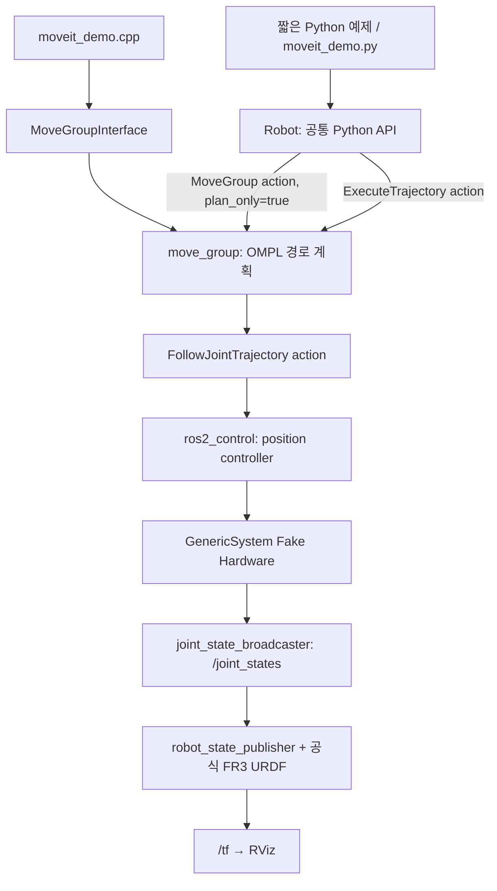
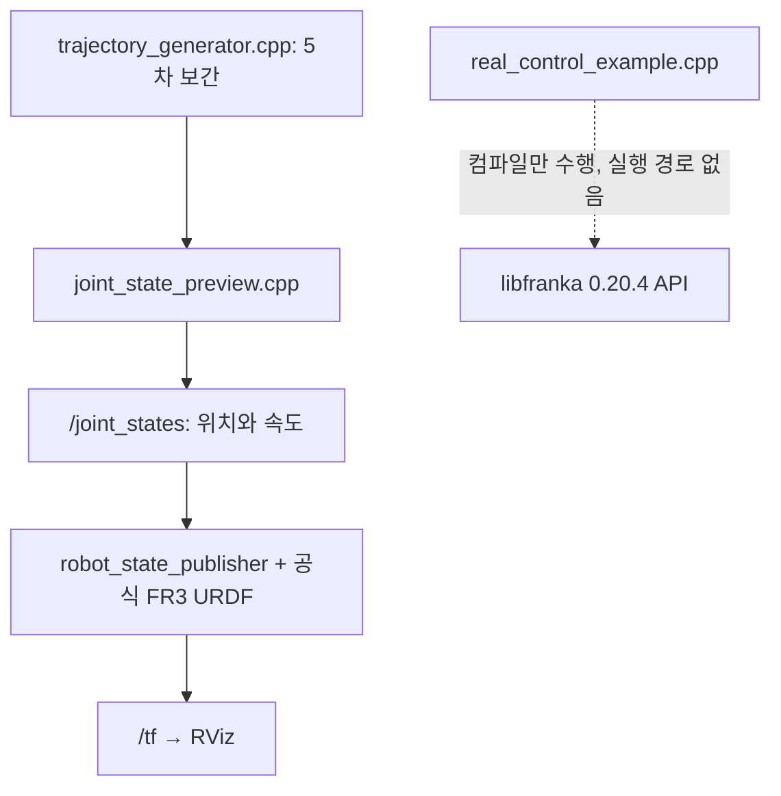
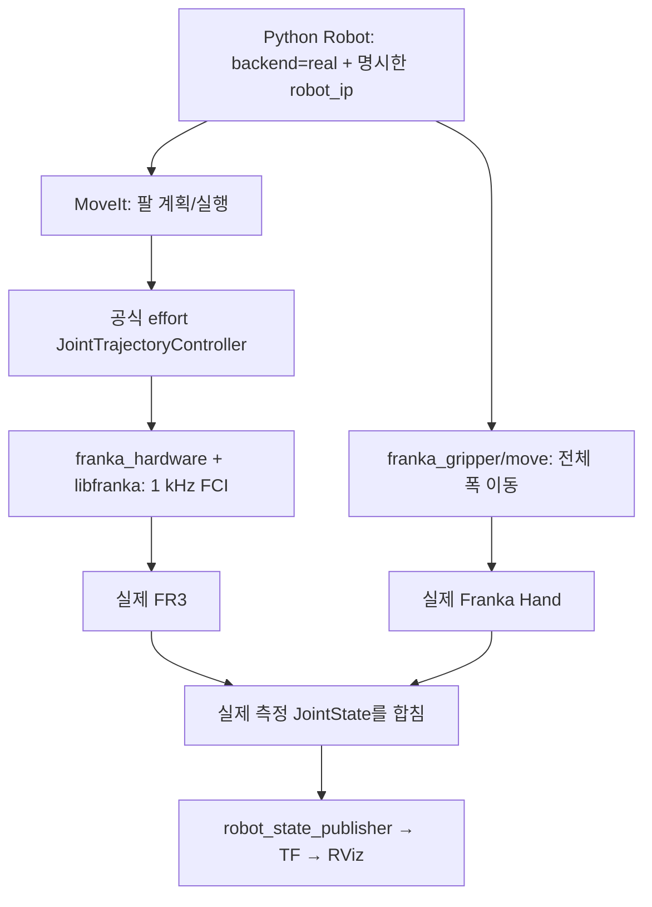

# FR3 Control Demo

## 1. 프로젝트 소개

Ubuntu 22.04 + ROS2 Humble에서 Franka Research 3(FR3)를 제어하고 구조를 배우는 프로젝트다. **기본은 Python이며, ROS가 없는 Ubuntu 22.04에서도 저장소를 복제하고 설치부터 가상 팔/그리퍼 실행까지 한 명령으로 시작한다.** 실물 FR3는 준비한 native Ubuntu PC에서 명시적인 별도 명령으로 연결하고 움직인다. FR3는 7개 회전 관절을 가진 연구용 로봇팔이며 공식 URDF와 메시를 사용한다. C++17 MoveIt 예제와 오프라인 궤적 계산기도 학습 자료로 유지한다.

같은 예제인 **Joint 4를 +0.1 rad 이동**을 두 구조로 비교한다. MoveIt2는 기존 플래너로 경로를 계획하고 ros2_control Fake Hardware에서 실행한다. Offline Preview는 직접 5차 다항식으로 관절 궤적을 계산하고 ROS2 메시지로 시각화한다.

**기본 실행과 Offline Preview는 실제 로봇에 연결하지 않는다.** 실물 연결은 `real-server`, 상태 확인은 `real-state`, 이동은 `real-command`로 분리한다. Offline Preview는 libfranka의 FCI를 에뮬레이션하지 않는다. 별도 C++ API 학습 파일은 컴파일만 하며, 실물 실행은 공식 ROS2 드라이버를 통해 요청한다. **실제 FR3 연결과 동작은 이 개발 환경에서 검증하지 않았다.**

| 항목 | 기준 |
|---|---|
| 운영체제 | 가상: Ubuntu 22.04 / WSL2 Ubuntu 22.04. 실물: native Ubuntu 22.04 + PREEMPT_RT |
| ROS2 / 언어 | Humble / C++17, Python 3 |
| 빌드 / 시각화 | CMake, colcon / RViz2 |
| franka_ros2 | Humble 브랜치의 `3b50164eabbe2d461baca007bbbbe03c024387bd` |
| 모델 / API | franka_description 2.8.1 / libfranka 0.20.4 |
| 의존성 기준 | 위 공식 커밋의 `dependency.repos` |
| 실물 로봇 시스템 | 현재 고정 libfranka의 요구 조건은 FR3 System Image 5.9.0 이상 |

Franka 공식 패키지 일부는 C++20을 사용한다. 학습용 C++ 예제와 오프라인 계산기는 C++17이다. 외부 공식 소스는 `ros2_ws/src/vendor/`에 내려받고 Git에 포함하지 않는다.

MoveIt 가상 데모는 C++과 Python에서 같은 계획 서버를 사용하며 공식 Franka Hand의 열기/닫기를 제공한다. 실물 실행은 Python API와 공식 Franka 드라이버를 사용하고, 그리퍼는 자유 공간의 폭 이동만 요청한다. 실물 그리퍼 힘/접촉 제어, RealSense, 사용자 작성 Torque/Impedance 제어기, 자체 IK/충돌 회피, Pick & Place, Gazebo, Isaac Sim, Docker 배포는 구현하지 않는다. 공식 실물 팔 컨트롤러 내부는 effort 명령을 사용한다. Offline Preview의 5차 계산기는 C++17이며 팔 7개 관절만 재생한다.

실제로 수행한 빌드, 테스트, 실행 결과와 미검증 항목은 [검증 기록](docs/validation.md)에 정리한다. 아래 출력과 화면 설명은 기본 옵션에서 확인할 동작을 안내한다.

아무것도 설치하지 않은 Ubuntu 22.04에서는 다음으로 시작한다. Git 설치와 setup은 시스템 패키지를 변경하므로 [설치 가이드](#4-설치-가이드)의 변경 범위를 확인한다.

```bash
sudo apt update
sudo apt install -y git
git clone https://github.com/LeeMin-hyeong/franka-demo.git
cd franka-demo
./scripts/start.sh
```

`start.sh`는 ROS/의존성 설치 → 빌드 → 설치 점검 → Python 가상 예제를 실행한다. Home → Joint 4 +0.1 rad → 그리퍼 40 mm → Home 순서로 재생하고 RViz를 유지한다. 화면이 없는 서버에서는 `./scripts/start.sh --no-rviz`를 사용한다. 이후에는 설치를 반복하지 않고 `./scripts/run.sh` 또는 `./scripts/run.sh example`을 실행한다. 자신의 작업은 [basic_sequence.py](ros2_ws/src/fr3_moveit_demo/examples/basic_sequence.py)의 함수 호출부터 수정하면 된다. [Python API 안내](docs/python-api.md)와 [실물 연결 가이드](docs/real-robot.md)에 확장 경로를 정리했다.

소프트웨어 설치만으로 실물을 바로 움직일 수 있는 것은 아니다. RT 커널과 권한, Control LAN 연결, 로봇 시스템 호환성, FCI 라이선스/활성화는 실제 장비에서 먼저 준비한다. setup은 커널, 네트워크, 로봇 펌웨어와 Desk 설정을 자동 변경하지 않는다.

## 2. 제어 방식 비교

| 항목 | MoveIt2 Fake Hardware | MoveIt2 실물 FR3 | libfranka 학습용 Offline Preview |
|---|---|---|---|
| 제어 API | Python 공식 ROS2 액션, C++ `MoveGroupInterface` | Python 공식 ROS2 액션 | 직접 작성한 C++ `QuinticTrajectory` |
| 필요한 라이브러리 | rclpy/moveit_msgs 또는 rclcpp, MoveIt2, ros2_control | 왼쪽 + 공식 franka_hardware/libfranka, 손 사용 시 franka_gripper | 표준 C++17 계산기, ROS 노드에 rclcpp/sensor_msgs/urdf |
| ROS2 의존성 | 계획과 가상 실행에 필요 | 계획과 실제 드라이버 실행에 필요 | 콘솔은 불필요, RViz 연결에 필요 |
| 경로 생성 | OMPL/MoveIt 플래너와 시간 매개화 | 팔은 같은 플래너, 손은 공식 Move 액션 | 시작/목표 관절각 사이 5차 보간 |
| 실제 로봇 연결 | 없음 | `real-*` 명령에서 명시적으로 연결 | 없음, `franka::Robot`을 링크하거나 생성하지 않음 |
| RViz 시각화 | 가상 컨트롤러 상태 → JointState → TF | 측정 상태 → JointState → TF | 계산한 샘플 → JointState → TF |
| 충돌 검사 | MoveIt의 모델/Planning Scene 기준 | 팔은 모델/Planning Scene 기준, 손의 직접 Move는 경로 충돌 검사 없음 | 없음 |
| 한계 | 동역학/접촉/센서 재현 없음 | 장비/하중/환경/통신을 별도 확인해야 하며 실물 Not Tested | 물리/FCI/컨트롤러 재현 없음 |

MoveIt의 환경 장애물 검사는 Planning Scene에 등록한 물체를 기준으로 한다. 데모는 별도 장애물을 추가하지 않는다. 실제 주변 물체가 자동으로 모델에 들어가지는 않으며, 충돌 검사 성공이 실물 동작의 안전성을 보증하지 않는다. Offline Preview는 관절 제한을 만족해도 자기 충돌이 있을 수 있다.

## 3. 시스템 아키텍처





실물은 같은 Python API를 명시적으로 `real`로 선택한다. 팔은 MoveIt으로 계획하고 공식 effort 컨트롤러/Franka 드라이버가 FCI를 담당한다. 손은 별도의 공식 Move 액션으로 폭을 지정한다.



URDF는 링크 형상, 관절, 제한을 정의하고 SRDF는 계획 그룹, 충돌 예외, Named State를 정의한다. 팔 계획 그룹은 `fr3_arm`, 관절은 `fr3_joint1`부터 `fr3_joint7`이다. MoveIt의 그리퍼 그룹은 `fr3_hand`이며 `fr3_finger_joint2`는 `fr3_finger_joint1`을 따라가는 mimic 관절이다. 파일 관계는 [architecture.md](docs/architecture.md)를 참고한다.

공식 SRDF의 `ready`를 Home으로 재사용한다. 관절각은 `[0, -π/4, 0, -3π/4, 0, π/2, π/4]` rad이다. 모두 0인 자세는 Joint 4와 Joint 6의 모델 제한을 벗어나 사용하지 않는다.

| 관절 | 위치 하한 [rad] | 위치 상한 [rad] | 모델 속도 상한 [rad/s] |
|---|---:|---:|---:|
| 1 | -2.9007 | 2.9007 | 2.62 |
| 2 | -1.8361 | 1.8361 | 2.62 |
| 3 | -2.9007 | 2.9007 | 2.62 |
| 4 | -3.0770 | -0.1169 | 2.62 |
| 5 | -2.8763 | 2.8763 | 5.26 |
| 6 | 0.4398 | 4.6216 | 4.18 |
| 7 | -3.0508 | 3.0508 | 5.26 |

위 값은 [공식 description 2.8.1](https://github.com/frankarobotics/franka_description/blob/2.8.1/robots/fr3/joint_limits.yaml)의 고정 모델 제한이다. 실제 FCI의 위치 의존 속도 제한과 같은 개념으로 취급하지 않는다.

## 4. 설치 가이드

### 4.1 WSL2 Ubuntu 22.04 터미널

Windows PowerShell에서 배포판 이름을 확인하고 Ubuntu 터미널을 연다.

```powershell
wsl --list --verbose
wsl -d Ubuntu-22.04
```

Ubuntu Bash에서 환경을 확인한다. 이후 Bash 명령은 모두 이 터미널에서 실행한다.

```bash
cat /etc/os-release
printf 'DISPLAY=%s\n' "$DISPLAY"
```

`VERSION_ID="22.04"`가 보여야 한다. RViz는 WSLg를 사용하므로 `DISPLAY`가 비어 있으면 WSL GUI 환경을 확인한다. native Ubuntu Desktop 사용자도 다음 단계부터 같은 Bash 명령을 사용한다. 실물 제어는 WSL2에서 실행하지 않는다.

### 4.2 아무것도 없는 Ubuntu에서 시작

Ubuntu Desktop 22.04 또는 WSL2 Ubuntu 22.04의 Bash에서 실행한다. Git도 없다면 먼저 설치한다. 복제 명령의 원격 주소는 이 저장소의 origin이다.

```bash
sudo apt update
sudo apt install -y git
git --version
git clone https://github.com/LeeMin-hyeong/franka-demo.git
cd franka-demo
./scripts/start.sh
```

Git은 저장소와 공식 소스를 가져오는 데 필요하다. `git --version`과 `ls scripts/start.sh`로 설치/복제를 확인한다. apt 실패는 인터넷과 sudo 권한을, clone 실패는 원격 주소와 계정 권한을 확인한다. 이미 복제한 저장소에서는 다시 clone하지 않는다. 현재 Windows 작업 폴더를 사용한다면 Ubuntu에서 `cd /mnt/c/Users/lmhst/git/franka-demo`로 이동할 수 있다.

`start.sh`는 다음 순서를 수행한다.

1. `setup.sh`: ROS가 없으면 ROS2 Humble부터 설치하고 공식 Franka 의존성을 준비한다.
2. `build.sh`: 프로젝트와 필요한 공식 패키지를 빌드한다.
3. `doctor.sh`: 소스 버전, 설치 패키지와 Python import를 확인한다.
4. `run.sh example`: Python으로 가상 팔과 그리퍼의 네 단계 예제를 실행한다.

설치 중 sudo 비밀번호를 요청할 수 있다. 처음 빌드는 패키지 다운로드와 C++ 컴파일 때문에 시간이 걸린다. `SEQUENCE COMPLETE`와 RViz의 ready 팔 자세/40 mm 그리퍼 폭을 확인한다. 종료는 Ctrl+C다. GUI가 없는 서버에서는 `./scripts/start.sh --no-rviz`를 사용하며 터미널의 최종 상태로 확인한다. 실물 서버는 자동으로 시작하지 않는다.

아래 단계의 자동 설치와 기존 ROS가 있는 환경의 재사용 동작을 구분한다. 실제 수행한 검증은 [검증 기록](docs/validation.md)에 있다. 완전한 신규 OS에서의 전체 설치/실행은 아직 미검증이다.

### 4.3 setup이 설치하고 보존하는 것

개별 단계로 실행하거나 설치 오류만 다시 확인하려면 다음 명령을 쓴다.

```bash
./scripts/setup.sh
```

ROS가 없는 경우 `bootstrap_ros.sh`가 UTF-8 로케일을 생성하고 이번 설치 프로세스에 적용하며, Ubuntu Universe와 공식 ROS apt 저장소를 준비한다. 기존 수동 ROS apt 설정 또는 설치된 `ros2-apt-source`는 그대로 사용한다. ROS 저장소가 없으면 공식 최신 `ros2-apt-source`의 Jammy 패키지를 설치한다. 이어 **`apt-get upgrade -y --no-remove`로 시스템 패키지를 업데이트**하고 `ros-humble-desktop`, `ros-dev-tools`를 설치한다. 신규 Jammy의 systemd/udev 갱신은 [공식 Humble 설치 안내](https://github.com/ros2/ros2_documentation/blob/humble/source/Installation/Ubuntu-Install-Debs.rst)를 따른다.

ROS2 Humble이 `/opt/ros/humble`에 이미 있으면 최초 ROS 설치 단계를 생략한다. 공통 setup은 MoveIt2, ros2_control/controllers, RViz, Xacro, Python ROS 액션/설치 도구와 빌드 도구를 설치한다. libfranka에 필요한 Eigen/Poco/fmt/Pinocchio/TinyXML2/console_bridge도 포함한다. 기존 MoveIt과 ABI가 섞이지 않게 관련 Humble 패키지를 함께 준비한다.

**시스템 변경 범위:** apt 패키지 추가/갱신, 신규 ROS apt 저장소/서명키, 필요한 UTF-8 locale 생성과 Universe 활성화, 최초 rosdep 설정. `--no-remove`는 기존 패키지 제거가 필요한 의존성 해결을 중단한다. 사용자의 `.bashrc`와 기본 locale, 기존 워크스페이스와 소스는 덮어쓰거나 삭제하지 않는다. RT 커널, 실시간 권한 파일, 네트워크 주소, 로봇 펌웨어와 Desk 설정도 변경하지 않는다.

```bash
source /opt/ros/humble/setup.bash
printenv ROS_DISTRO
ros2 pkg prefix rviz2
```

`humble`과 RViz 설치 경로가 보여야 한다. ros2가 없거나 패키지를 못 찾으면 setup의 첫 apt 오류와 ROS apt 설정을 확인한다. GitHub API/다운로드 실패, sudo 또는 apt 잠금 오류가 발생하면 원인을 해결하고 setup을 다시 실행한다. 기존 소스를 지우고 시작할 필요가 없다.

Humble 고정 커밋은 `scripts/upstream.repos`로 가져오고 그 안의 공식 `dependency.repos`를 재귀적으로 가져온다. `--skip-existing`으로 소스를 중복 다운로드하지 않는다. 기존 버전이 다르면 자동 checkout/reset 대신 중단한다. 모바일/Gazebo/테스트 의존성은 설치 범위에서 제외한다.

```bash
git -C ros2_ws/src/vendor/franka_ros2 rev-parse HEAD
git -C ros2_ws/src/vendor/libfranka describe --tags --exact-match
git -C ros2_ws/src/vendor/franka_description describe --tags --exact-match
```

커밋 `3b50164…`, 태그 `0.20.4`, `2.8.1`이 각각 나와야 한다. 최종 소스 버전은 `ros2_ws/sources.lock.repos`에도 기록한다. 의존성이 이미 준비된 환경에서는 `./scripts/setup.sh --sources-only`로 소스만 준비할 수 있다. 이 옵션은 ROS와 git/vcs를 설치하지 않으므로 최초 설치용이 아니다.

### 4.4 빌드와 확인

```bash
./scripts/build.sh
source /opt/ros/humble/setup.bash
source ros2_ws/install/setup.bash
ros2 pkg prefix fr3_moveit_demo
ros2 pkg prefix fr3_offline_preview
./scripts/doctor.sh
```

필요한 공식 ROS 패키지와 두 데모만 colcon의 `--paths`로 발견해서 빌드한다. 공식 저장소 전체를 자동 발견하면 범위 밖 모바일/Gazebo 패키지의 실행/테스트 의존성을 함께 고려할 수 있어 발견 경로를 명시한다.

이어 standalone 계산기와 CTest를 빌드하고 libfranka 0.20.4 API 파일을 OBJECT로 컴파일한다. OBJECT는 실행 파일이 아니며 로봇 연결을 실행하지 않는다. 자체 CMake API 옵션은 기본 OFF이고 전체 build.sh만 컴파일 검사를 위해 ON으로 지정한다.

두 패키지 경로와 CTest 결과, doctor의 설치/import `OK`를 확인한다. doctor는 파일/패키지 검사이며 로봇 접속이나 제어 명령을 보내지 않는다. 첫 컴파일 오류부터 살펴본다. `cc1plus killed`는 메모리 부족일 수 있으므로 `FR3_BUILD_JOBS=1 ./scripts/build.sh`로 재시도한다. 스크립트는 기존 build/install/src를 삭제하지 않는다.

자동 검사를 재현하려면 빌드와 환경 source 후 다음을 실행한다.

```bash
bash tests/test_bootstrap.sh
python3 tests/check_robot_guards.py
python3 tests/check_cli_defaults.py
python3 tests/check_real_configuration.py
./scripts/smoke_test.sh
```

첫 검사는 설치 명령을 대체해 ROS 없는 설치 분기와 실패 처리를 검사한다. 중간 검사는 실제 연결 없이 모델, IP, 정지/측정 상태와 CLI 기본 목표를 확인한다. 마지막 검사는 기본 ROS 도메인 79에서 headless Fake Hardware와 Python 팔/그리퍼 예제를 실제 실행하고 새 상태로 ready/40 mm 결과를 확인한다. ROS_DOMAIN_ID를 직접 지정하면 그 값을 사용하므로 기존 서버와 다른 도메인을 선택한다. 모두 실물 FCI를 호출하지 않는다. GitHub의 Ubuntu 22.04 CI도 같은 설치/빌드/검사 경로를 사용하며 현재 CI 실행 결과는 미검증이다.

```bash
./scripts/build.sh --offline-only
./standalone/libfranka_demo/build/offline_demo --joint 4 --delta 0.1 --duration 3 --rate 30
```

ROS/libfranka 없이 계산기만 확인하는 선택 경로다. C++17 컴파일러와 CMake는 필요하다. START/GOAL/FINAL과 샘플 수를 출력하고 실제 시간 재생이나 RViz 실행은 하지 않는다. 전체 빌드 후에도 이 프로그램을 따로 사용할 수 있다.

## 5. 실행 가이드

### 5.1 MoveIt2 시작과 관절 이동

저장소 루트의 Ubuntu 터미널 A에서 실행한다. 스크립트가 ROS 환경을 source한다.

```bash
./scripts/run.sh
```

Fake Hardware, MoveIt, 상태 발행, TF, RViz를 시작하고 Python 클라이언트를 실행한다. `./scripts/run.sh moveit`도 같은 명령이다. 컨트롤러가 active가 될 때까지 최대 90초 기다리고, 클라이언트는 MoveIt 액션 서버를 최대 30초 기다린다. GUI 실행은 모델을 읽고 초기 자세를 확인할 수 있도록 컨트롤러 준비 후 10초 더 기다린다. 한 번 이동한 뒤 RViz를 유지한다. 현재 상태가 없거나 상태 발행자가 중복되면 이동을 거부한다.

기본 옵션의 핵심 로그는 다음과 같다. 시간/프로세스 번호와 계획 시간은 실행마다 다르다.

```text
FR3 MoveIt2 (Python): Fake Hardware를 시작합니다. 실제 로봇에 연결하지 않습니다.
START fr3_joint4 = -2.356194 rad
GOAL fr3_joint4 = -2.256194 rad
Planning SUCCESS. Requested minimum 3.000 s; execution ...
FINAL fr3_joint4 = -2.256171 rad
Execution SUCCESS. Final JointState matches goal (tolerance 0.002 rad).
```

RViz PlanningScene에서 Franka Hand가 장착된 FR3의 ready 초기 자세와 움직임을 확인한다. 팔 계획 그룹은 공식 SRDF의 fr3_arm이다. 그리퍼 초기 전체 폭은 공식 SRDF open 상태인 0.07 m다. Trajectory의 계획 경로 표시와 PlanningScene의 가상 상태 표시는 서로 다른 데이터다. 실행 성공은 컨트롤러 응답과 실행 후 새 관절 상태로 판정한다. 팔 모드의 시작/목표/최종 7개 관절은 터미널에 출력한다.

```bash
./scripts/run.sh moveit --joint 4 --delta 0.1 --duration 3
```

원하는 옵션으로 새 스택을 시작하는 예시다. 이미 A에서 실행 중이라면 중복 실행하지 않고 터미널 B에서 다음 명령을 사용한다.

```bash
cd /mnt/c/Users/lmhst/git/franka-demo
./scripts/run.sh moveit-command --joint 4 --delta -0.1 --duration 3
./scripts/run.sh moveit-command --home --duration 5
```

B는 현재값 기준 상대 이동과 공식 ready 복귀를 요청하며 완료 후 끝난다. A에서 `Ctrl+C`를 누르면 launch와 관련 노드를 종료한다. 초기 ready에서 +0.1 후 -0.1을 실행하면 Joint 4가 초기값으로 돌아간다.

| 옵션 | 의미 / 범위 |
|---|---|
| `--language` | MoveIt 전용 python 또는 cpp, 기본 python. example은 Python 전용 |
| `--gripper-width` | MoveIt 전용, 두 손가락 사이 목표 전체 폭 0~0.08 m. 팔 옵션과 동시 지정 불가 |
| `--joint` | 관절 1~7, 기본 4 |
| `--delta` | 상대 이동 rad, 기본 +0.1, 목표 제한 초과 시 거부 |
| `--duration` | 양수 s, 기본 3, MoveIt에서는 최소 실행 시간 |
| `--rate` | Offline Preview 전용 1~1000 Hz, run.sh 기본 30 |
| `--home` | MoveIt 전용, 공식 ready 사용 |
| `--no-rviz` | RViz 없이 실행하는 검증 옵션 |

MoveIt 원래 계획이 3초보다 길면 그대로 실행한다. 짧으면 시간과 미분값을 함께 조정해 느리게 만든다. 모든 경로가 정확히 3초가 되는 것은 아니다. MoveIt의 duration 상한은 3600초다.

### 5.2 공식 Fake Hardware 명령과 데모 구성

공식 설치 확인 명령은 다음과 같다.

```bash
source /opt/ros/humble/setup.bash
source ros2_ws/install/setup.bash
ros2 launch franka_fr3_moveit_config moveit.launch.py \
  robot_ip:=dont-care use_fake_hardware:=true load_gripper:=false ee_id:=none
```

**고정한 공식 Humble 구성에는 가상 실행에 영향을 주는 세 항목이 있다.** load_gripper=false여도 그리퍼 launch를 포함한다. 팔은 effort 명령을 사용하지만 GenericSystem은 effort를 위치 변화로 적분하지 않는다. 공식 RViz의 이전 그룹명 fr3_manipulator도 현재 SRDF와 다르다.

학습용 이동은 run.sh의 `fake_moveit.launch.py`를 사용한다. 공식 모델/OMPL/관절/게인을 읽고 가상 팔의 position 인터페이스를 임시 파라미터로 지정한다. 공식 그리퍼 형상과 mimic을 보존하면서 GenericSystem에 손가락 상태와 위치 명령 인터페이스를 메모리에서 추가한다. 실제 Franka 그리퍼 노드 대신 가상 `fr3_hand_controller`를 사용한다. RViz는 공식 PlanningScene/Trajectory 표시를 유지하고 CLI에서 쓰지 않는 비활성 MotionPlanning 패널을 제외하며 창 크기와 시점을 조정한다. 공식 소스를 수정하지 않는다. 위 공식 명령 실행만으로 데모 이동 성공을 선언하지 않는다.

### 5.3 libfranka 학습용 Offline Preview

MoveIt을 종료한 뒤 Ubuntu 터미널 A에서 실행한다.

```bash
./scripts/run.sh libfranka-preview
```

공식 URDF, robot_state_publisher, C++ JointState 노드와 RViz를 실행한다. WSL에서 RViz 모델 초기화를 기다리도록 초기 자세를 15초 유지하고 3초 궤적을 재생한 뒤 최종 자세를 계속 발행한다. RViz RobotModel에서 팔이 움직이며 MoveIt과 ros2_control은 실행되지 않는다. 처음에는 움직이지 않는 것이 정상이며 터미널의 대기 시간 로그를 확인한다.

```text
Offline Preview: 실제 libfranka FCI 제어를 실행하지 않습니다.
OFFLINE PREVIEW: no franka::Robot, no Robot::control(), no FCI connection.
START fr3_joint4 = -2.356194 rad
GOAL fr3_joint4 = -2.256194 rad
FINAL fr3_joint4 = -2.256194 rad
Preview COMPLETE. Holding final pose; Ctrl+C to stop. No FCI API called.
```

```bash
./scripts/run.sh libfranka-preview --joint 4 --delta 0.1 --duration 3 --rate 30
```

관절, 이동량, 수학적 이동 시간 T, 메시지 주파수를 바꾼다. T는 보간식의 시간이며 타이머 지연으로 마지막 메시지 도착은 늦을 수 있다. 1000 Hz를 지정해도 FCI 실시간 1 kHz 성능을 보장하지 않는다. 직접 launch와 콘솔 프로그램의 rate 기본값은 100 Hz다.

매 실행은 ready에서 시작한다. 재생 중 목표 변경은 없으며 Ctrl+C로 종료하고 다시 실행한다. `--delta 0`은 ready를 유지하고 `--home`은 MoveIt 전용이다. 지나치게 짧은 duration은 속도/가속도 검사에서 거부된다.

### 5.4 상태 확인

다른 Ubuntu 터미널에서 저장소 루트로 이동하고 확인한다.

```bash
source /opt/ros/humble/setup.bash
source ros2_ws/install/setup.bash
ros2 topic echo /joint_states sensor_msgs/msg/JointState --once --no-daemon
ros2 topic info /joint_states --verbose --no-daemon
ros2 run tf2_ros tf2_echo fr3_link0 fr3_link7
```

MoveIt에서는 팔 7개와 손가락 2개, 총 9개 name과 같은 순서의 position을 확인한다. Offline Preview는 팔 7개다. Publisher count는 1이고 TF는 갱신되어야 한다. MoveIt 전용 `ros2 control list_controllers`에서는 fr3_arm_controller, fr3_hand_controller와 joint_state_broadcaster가 active여야 한다. 검증용 실행은 각 모드에 `--no-rviz`를 추가한다.

두 방식은 같은 ROS_DOMAIN_ID에서 동시에 실행하지 않는다. 다른 실험과 분리하려면 새 터미널마다 동일한 `export ROS_DOMAIN_ID=42`를 지정하고 데모/확인 명령을 실행한다.

### 5.5 Python 기본과 C++ 학습 예제

두 버전은 같은 공식 FR3 모델, MoveIt 플래너, Fake Hardware를 사용하며 기본 동작은 Joint 4를 +0.1 rad 이동하는 것이다. 다음 중 하나를 실행한다. 이전 데모가 실행 중이면 먼저 Ctrl+C로 종료한다.

```bash
# Python 기본 버전
./scripts/run.sh --joint 4 --delta 0.1 --duration 3

# C++ MoveGroupInterface 학습 버전
./scripts/run.sh moveit --language cpp --joint 4 --delta 0.1 --duration 3
```

각 명령은 RViz와 Fake Hardware를 함께 시작하고 한 번 이동한 뒤 화면을 유지한다. `START`, `GOAL`, `Planning SUCCESS`, `FINAL`, `Execution SUCCESS`를 확인한다. RViz의 PlanningScene은 실행된 현재 자세, Trajectory는 계획 경로를 보여준다. 이동 완료 후 실행 터미널의 Ctrl+C로 종료한다.

실행 중인 스택에 Python으로 추가 명령을 보낼 때는 다른 Ubuntu 터미널에서 사용한다.

```bash
./scripts/run.sh moveit-command --language python --joint 4 --delta -0.1 --duration 3
./scripts/run.sh moveit-command --language python --home --duration 5
```

Python CLI는 `scripts/moveit_demo.py`, 공통 제어는 `fr3_moveit_demo/robot.py`, C++ 예제는 `src/moveit_demo.cpp`에 있다. 모두 `ros2_ws/src/fr3_moveit_demo/` 기준이다. 수정 후 `./scripts/build.sh`를 실행한다. Python 모듈과 예제도 패키지에 설치되므로 최초 빌드는 필요하다. Python 버전은 `rclpy`, `moveit_msgs`와 표준 XML 모듈을 사용하며 추가 pip 패키지는 필요하지 않다.

간단한 코드 읽기 순서와 직접 ROS 파라미터로 실행하는 방법은 [RViz 데모 안내](docs/rviz-demo.md)를 참고한다. 정상 종료의 알려진 upstream 한계는 [검증 기록](docs/validation.md)에서 별도로 확인한다.

### 5.6 가상 그리퍼 열기와 닫기

Ubuntu 터미널 A에서 기본 Python으로 그리퍼를 열고 RViz 스택을 유지한다.

```bash
./scripts/run.sh moveit --gripper-width 0.08 --duration 3
```

터미널 B에서 Python으로 닫고 다시 연다. 저장소 루트에서 차례로 실행한다.

```bash
./scripts/run.sh moveit-command --language python --gripper-width 0 --duration 3
./scripts/run.sh moveit-command --language python --gripper-width 0.04 --duration 3
```

두 버전 모두 `--gripper-width`를 지원한다. 값은 **한 손가락 위치가 아닌 전체 벌림 폭 [m]**이며 0.08은 80 mm다. 각 손가락의 [공식 URDF 제한](https://github.com/frankarobotics/franka_description/blob/2.8.1/end_effectors/common/franka_hand.xacro)은 0~0.04 m이므로 목표는 폭의 절반으로 설정한다. 독립적으로 계획하는 관절은 finger_joint1 하나이고 finger_joint2는 따라간다. [공식 SRDF](https://github.com/frankarobotics/franka_description/blob/2.8.1/end_effectors/franka_hand/franka_hand.srdf.xacro)의 open은 전체 0.07 m, close는 0 m다. 기본 초기화는 open이며 CLI에서 0.08까지 지정할 수 있다.

터미널에서 손가락의 START/GOAL/FINAL [m]과 `gripper_width`를 확인한다. RViz에서는 두 손가락이 대칭으로 벌어지거나 닫힌다. 최종 손가락 위치를 목표와 0.0002 m 이내로 비교한다. `--joint`, `--delta`, `--home`과 함께 지정하면 모호한 요청으로 거부한다. 그리퍼를 움직인 뒤 팔을 움직이려면 별도의 moveit-command를 보낸다.

실행 시간은 팔과 마찬가지로 최소 시간이다. 범위 밖 목표는 거부하며 힘, 물체 접촉, grasp 성공은 시뮬레이션하지 않는다. 실제 libfranka Gripper API를 호출하지 않는다. Offline Preview의 `--gripper-width`는 지원하지 않으며 명시적으로 거부한다. 종료는 터미널 A에서 Ctrl+C다.

### 5.7 짧은 Python 예제와 직접 확장

기존 데모를 종료한 뒤 한 명령으로 네 단계 예제를 실행한다.

```bash
./scripts/run.sh example
```

Home → Joint 4 +0.1 rad → 그리퍼 전체 폭 0.04 m → Home 순서다. 각 단계의 계획/실행 결과 뒤에 `SEQUENCE COMPLETE`와 최종 관절값이 출력된다. RViz에는 ready 팔 자세와 40 mm 폭의 그리퍼가 남는다. `--duration 5`로 각 단계의 최소 시간을 변경할 수 있다. Ctrl+C로 종료한다.

직접 코드를 실행하려면 서버와 작업을 두 터미널로 나눈다. 터미널 A는 자동 이동 없이 모델과 서버를 준비한다.

```bash
./scripts/run.sh server
```

같은 저장소의 터미널 B에서 예제를 실행하거나 상태만 읽는다.

```bash
./scripts/run.sh example-command --duration 3

source /opt/ros/humble/setup.bash
source ros2_ws/install/setup.bash
ros2 run fr3_moveit_demo read_state.py
```

`read_state.py`는 9개 관절 위치를 이름과 단위로 출력하며 이동 요청을 하지 않는다. 서버 없이 실행하면 연결 timeout으로 실패한다. 자신의 Python 코드도 이 서버에 연결한다.

```python
from fr3_moveit_demo import Robot

with Robot() as robot:
    robot.home()
    robot.move_joint(joint=4, delta=0.1, duration=3.0)
    robot.set_gripper(width=0.04)
    positions = robot.get_joint_positions()
```

메서드는 완료와 최종 상태 검증까지 기다린다. 실패하면 예외를 전달하므로 다음 단계가 실행되지 않는다. `with`가 본인의 ROS 자원을 정리한다. `home()`은 팔만 ready로 이동하며 그리퍼 폭은 유지한다. 이미 목표에 도달한 정지 계획은 새 상태를 확인하고 `Goal SUCCESS`로 완료하며 0초 궤적을 실행하지 않는다. 이 API는 같은 스레드에서 순서대로 사용한다.

저장소의 확장 위치는 다음처럼 나뉜다. 새로운 작업 순서를 추가하는 단계에서는 예제 파일만 수정하면 된다.

```text
franka-demo/
├── scripts/                         설치, 빌드, 실행 진입점
├── ros2_ws/src/fr3_moveit_demo/
│   ├── examples/                    짧은 Python 작업과 상태 확인
│   ├── fr3_moveit_demo/robot.py      공통 Python 제어 API
│   ├── scripts/moveit_demo.py       CLI 입력을 API 호출로 변환
│   ├── launch/fake_moveit.launch.py 모델과 가상 실행 환경 구성
│   ├── launch/real_moveit.launch.py  공식 실물 드라이버와 측정 상태 구성
│   └── src/moveit_demo.cpp          C++ 학습 예제
├── ros2_ws/src/fr3_offline_preview/ 별도 C++ 궤적 시각화
├── standalone/libfranka_demo/      C++ 계산기와 실제 API 컴파일 자료
└── docs/                           API, 아키텍처, 검증 기록
```

Pose 목표, 센서, Isaac Sim 연결은 현재 API에 구현하지 않았다. 확장 경계와 반환값은 [Python API 안내](docs/python-api.md)를 참고한다.

### 5.8 실제 FR3 연결과 명시적인 이동

실물은 [실물 연결 가이드](docs/real-robot.md)에 따라 **native Ubuntu 22.04 + PREEMPT_RT/실시간 권한**, System Image 5.9.0 이상, Control LAN 직결과 FCI 활성화를 먼저 준비한다. 아래 IP는 공식 네트워크 예시이며 자신의 실제 Control 주소로 바꾼다. 실물 동작은 Not Tested다.

```bash
./scripts/setup.sh
./scripts/build.sh
./scripts/doctor.sh --real
```

setup/build는 소프트웨어를 준비한다. doctor는 현재 커널과 셸의 rtprio/memlock을 확인하며 접속하지 않는다. 실패하면 실물 가이드의 해당 준비 항목을 해결한다. 모든 `real-*` 스크립트는 같은 PC 검사를 수행하고 WSL2를 거부한다.

터미널 A에서 서버를 시작한다. 처음에는 그리퍼 없이 연결한다.

```bash
./scripts/run.sh real-server --robot-ip 172.16.0.2
```

공식 팔 effort 컨트롤러가 활성화되어 현재 자세 유지 제어를 시작한다. 자동 Home 또는 이동 목표는 보내지 않는다. RViz는 가상 ready 초기값이 아닌 수신한 실제 자세를 표시한다. Franka Hand가 실제 장착된 경우에만 서버 시작 옵션 `--with-gripper`를 추가한다. 화면이 없는 PC에서는 `--no-rviz`를 추가한다.

터미널 B에서 현재 상태를 확인한 뒤, 작업 공간과 로봇 상태를 확인하고 한 동작을 명시한다.

```bash
./scripts/run.sh real-state --robot-ip 172.16.0.2
./scripts/run.sh real-command --robot-ip 172.16.0.2 --joint 4 --delta 0.01 --duration 5
```

상태 조회는 추가 이동을 요청하지 않는다. 이동은 현재 관절값에서 Joint 4를 +0.01 rad 변경하고 계획/실행 결과와 새로운 최종 측정 상태를 확인한다. 일반 `moveit-command`는 실물 서버를 거부한다. 실물 명령은 Python 전용이며 관절+delta, home 또는 gripper-width 중 하나를 명시해야 한다. 옵션을 빼고 기본 +0.1 rad를 실물에 보내는 경로는 없다.

```bash
./scripts/run.sh real-command --robot-ip 172.16.0.2 --home --duration 5
```

Home은 공식 ready 목표까지 모든 팔 관절이 이동할 수 있다. 현재 자세에서 전체 경로를 확인한 뒤 사용한다. 그리퍼는 `--with-gripper`로 시작한 서버에서만 다음처럼 요청한다.

```bash
./scripts/run.sh real-command --robot-ip 172.16.0.2 --gripper-width 0.04 --duration 5
```

실물 손은 MoveIt의 가상 손 궤적 대신 `/franka_gripper/move`를 호출한다. 전체 폭은 m이며, 현재 폭과 duration으로 속도를 계산해 최대 0.05 m/s로 제한한다. duration은 속도 계산 기준이며 정확한 완료 시간을 보장하지 않는다. grasp/힘 제어/자동 homing을 수행하지 않으며 표준 손가락의 자유 공간 이동만 다룬다.

정상 종료는 A에서 Ctrl+C다. 클라이언트의 Ctrl+C는 소프트웨어 정지/취소 요청이며 물리적인 비상 정지를 대신하지 않는다. 실물 정지 결과가 불확실하면 같은 Robot 객체의 후속 이동을 막고 상태 조회/정지 재시도만 허용한다. 로봇 오류가 나면 후속 명령을 자동 재시도하거나 오류 복구하지 않는다. 실제 동작 성공 여부와 정지 성능은 연결한 장비에서 별도로 검증한다.

## 6. 핵심 코드 설명

### 6.1 MoveGroupInterface, 현재 상태와 목표

`moveit_demo.cpp`는 /move_group의 URDF/SRDF를 읽는다. GenericSystem이 없거나 실물 FrankaHardwareInterface가 있으면 거부한다. executor 스레드가 통신을 처리하는 동안 메인 스레드는 계획/실행을 기다린다.

```cpp
moveit::planning_interface::MoveGroupInterface move_group(
  node, "fr3_arm", std::shared_ptr<tf2_ros::Buffer>(),
  rclcpp::Duration::from_seconds(timeout));
move_group.startStateMonitor(timeout);
auto current = move_group.getCurrentState(timeout);
```

현재 상태 결과와 7개 관절의 실제 JointState 수신을 모두 검사한다. 목표는 `goal.at(joint - 1) += delta`로 현재값에서 계산하고 URDF 제한을 확인한다. Home은 `getNamedTargetValues("ready")`를 사용한다.

### 6.2 Planning과 Execution

```cpp
move_group.setStartState(*current);
std::map<std::string, double> joint_goal;
for (std::size_t i = 0; i < names.size(); ++i) {
  joint_goal[names[i]] = goal[i];
}
move_group.setJointValueTarget(joint_goal);
moveit::planning_interface::MoveGroupInterface::Plan plan;
const auto planned = move_group.plan(plan);
const double execution_duration = slow_plan(plan, duration);
const auto executed = move_group.execute(plan);
```

흐름 발췌이며 실제 파일은 각 단계의 반환값을 검사한다. plan은 계산만 하고 execute가 FollowJointTrajectory로 궤적을 전달한다. 실행 후 새 상태를 받아 목표와 0.002 rad 이내인지 확인한다. 목표 출력만으로 성공을 선언하지 않는다.

### 6.3 5차 궤적과 제한 검사

`trajectory_generator.cpp`는 u=t/T로 시간을 정규화한다.

```cpp
const double u = elapsed_s / duration_s_;
const double s = u * u * u * (10.0 + u * (-15.0 + 6.0 * u));
const double ds = 30.0 * u * u * (1.0 - u) * (1.0 - u);
const double dds = 60.0 * u * (1.0 - u) * (1.0 - 2.0 * u);
result.position[i] = start_[i] + s * delta;
result.velocity[i] = (delta / duration_s_) * ds;
result.acceleration[i] = (delta / duration_s_ / duration_s_) * dds;
```

`s=10u³-15u⁴+6u⁵`는 양 끝에서 `s'=s''=0`이므로 정지 상태와 속도/가속도를 연속으로 연결한다. 선형 보간은 정지 상태와 연결할 때 속도가 갑자기 바뀐다. t<=0은 정확한 시작값, t>=T는 목표값과 0 미분값을 반환한다.

샘플 사이 초과도 놓치지 않도록 최대 속도 `15|Δq|/(8T)`와 가속도 `10|Δq|/(√3 T²)`를 생성 시 검사한다. 가속도 한계는 libfranka 0.20.4 rate_limiting.h의 모든 관절 `9.999 rad/s²`다. 단조 보간이므로 양 끝 위치가 유효하면 사이도 위치 제한 안에 있다.

jerk, 위치 의존 속도 제한, 관성/하중, 충돌, FCI 필터/통신/실시간 성능은 검사하지 않는다. 모델 제한 검사는 실제 FR3 동작의 안전성을 의미하지 않는다.

### 6.4 JointState와 TF

```cpp
const auto sample = trajectory_->sample(elapsed);
std::copy(sample.position.begin(), sample.position.end(), message_.position.begin());
std::copy(sample.velocity.begin(), sample.velocity.end(), message_.velocity.begin());
message_.header.stamp = now();
publisher_->publish(message_);
```

`joint_state_preview.cpp`는 /joint_states에 name/position/velocity를 보내고 effort는 비운다. wall timer 콜백이 주기적으로 수행되며 steady_clock으로 경과 시간을 계산한다. robot_state_publisher는 위치+URDF로 TF를 계산한다. RViz는 표시 도구이며 제어기가 아니다.

### 6.5 Robot State, Motion Generator, FCI

`real_control_example.cpp`에는 main이 없다. 첫 문장이 무조건 예외를 던져 연결 코드까지 실행할 수 없고 아래 코드의 타입/API 문법만 컴파일러로 확인한다.

```cpp
franka::Robot robot(robot_address);
const franka::RobotState initial_state = robot.readOnce();
robot.control([&](const franka::RobotState& state,
                  franka::Duration period) -> franka::JointPositions {
  elapsed_s += period.toSec();
  const auto sample = trajectory.sample(elapsed_s);
  franka::JointPositions command(sample.position);
  if (elapsed_s >= trajectory.duration()) {
    return franka::MotionFinished(command);
  }
  return command;
});
```

주변 시작 상태 검사/예외 처리를 생략한 발췌다. Robot 생성자는 실제 연결을 수행하고 readOnce는 상태를 읽는다. q는 측정값, q_d는 로봇 상태의 desired(목표) 관절 위치다. q_d와 처리 전 원시 명령이 항상 같다고 가정하지 않는다. Motion Generator는 다음 JointPositions를 반환한다. period는 실제 호출 간격이고 MotionFinished는 종료 플래그를 설정한다. 예외는 다시 전달하며 Robot 소멸자가 자원을 정리한다.

### 6.6 Python 액션 클라이언트

`moveit_demo.py`는 ROS 파라미터를 읽어 `Robot`을 호출하는 작은 CLI다. 공통 동작은 `fr3_moveit_demo/robot.py`에 있다. `Robot`은 C++ MoveGroupInterface 대신 Humble의 공식 `moveit_msgs` 액션을 사용한다. 노드는 `/joint_states`를 구독하고 `/move_group`의 URDF/SRDF를 조회한다. 공식 모델과 현재 상태를 검증한 뒤 JointConstraint로 목표를 지정한다. 한 객체에서 여러 작업을 호출하면 모델과 액션 클라이언트를 재사용하고, 각 동작의 현재 상태는 새로 수신한다.

```python
plan_goal = MoveGroup.Goal()
plan_goal.request.group_name = 'fr3_arm'
plan_goal.planning_options.plan_only = True

execute_goal = ExecuteTrajectory.Goal()
execute_goal.trajectory = trajectory
```

계획 요청은 `/move_action`, 실행 요청은 `/execute_trajectory`로 보낸다. `plan_only=True`는 계획 단계에서 로봇을 움직이지 않도록 한다. 비동기 future를 기다리는 동안 executor가 상태 구독과 액션 응답을 처리한다. 목표 수락, 액션 완료 상태, MoveIt 오류 코드를 각각 확인한다. 실행 후 새 JointState를 받아 목표와 0.002 rad 이내인지 확인한다.

Python 클라이언트 실행 중 Ctrl+C는 본인의 가상 실행 목표에 공식 MoveGroupInterface.stop()과 같은 정지 이벤트를 보내고 취소/정지 결과를 확인한 뒤 종료한다. 정지 요청을 보냈다는 로그와 실제 PREEMPTED 결과를 구분한다.

Python도 MoveIt의 기존 경로 계획기를 사용한다. Offline Preview의 JointState 직접 발행과 구분한다. 기본 Python과 C++ 예제는 GenericSystem을 확인하고 실물 모델을 거부한다. Python을 `backend='real', robot_ip='...'`로 명시하면 반대로 공식 FrankaHardwareInterface와 서버 URDF의 IP 일치를 검사한다. 실물 손의 `set_gripper()`는 별도의 공식 Move 액션으로 전체 폭과 속도를 요청한다. C++ 학습 예제는 가상 전용으로 유지한다.

## 7. 기술적 차이

**Q. MoveIt2는 어떻게 로봇을 움직이는가?**

현재 상태와 목표를 받아 모델/Planning Scene 기준으로 계획한다. 시간 정보가 붙은 궤적을 컨트롤러에 전달하고 각 시점의 명령을 하드웨어 인터페이스에 쓴다. 가상에서는 GenericSystem이 위치 명령을 상태로 반영한다. 실물에서는 공식 effort 컨트롤러와 franka_hardware가 libfranka를 통해 실제 FR3로 명령을 전달한다.

**Q. libfranka는 MoveIt2와 무엇이 다른가?**

실제 Franka 로봇과 FCI로 상태/명령을 주고받는 C++ 라이브러리이며 MoveIt의 경로 계획을 대신하지 않는다. 이 오프라인 계산기는 Motion Generator의 입출력을 이해하기 위한 자료이며 libfranka 제어 루프를 실행하지 않는다.

**Q. 왜 libfranka를 URDF에 직접 연결할 수 없는가?**

URDF는 정적인 모델이며 네트워크 장치나 명령 수신기가 아니다. franka::Robot은 실제 주소/FCI를 필요로 한다. 모델 시각화에는 관절 상태를 ROS 메시지로 전달하고 TF를 계산하는 별도 단계가 필요하다.

**Q. Offline Preview와 실제 FCI 제어의 차이는 무엇인가?**

프리뷰는 계산한 값만 보낸다. 실물은 상태 피드백, 실제 콜백 주기, 연결 상태, 명령 연속성/제한, 실시간 네트워크를 다룬다. 부드러운 가상 화면이나 1000 Hz 타이머 설정은 FCI 검증이 아니다.

**Q. 이 구조를 실제 FR3로 확장하려면 무엇이 필요한가?**

실물 실행 진입점과 공식 드라이버 구성을 제공한다. 그러나 시스템/libfranka 호환성, FCI 라이선스/활성화, PREEMPT_RT/권한, Control LAN 직결, 하중/환경/로봇 상태와 현장 정지 절차는 장비에서 준비해야 한다. 상태 조회 → 작은 관절 목표 → 전체 경로 순서로 단계별 검증한다. WSL의 가상 성공과 C++ 컴파일 성공은 이 실물 검증을 대신하지 않는다. 구체적인 연결과 확인 명령은 [실물 가이드](docs/real-robot.md)에 있다.

## 8. Trouble Shooting

| 증상 | 확인과 해결 |
|---|---|
| ros2 명령/패키지 없음 | Ubuntu Bash 확인. `source /opt/ros/humble/setup.bash`와 `source ros2_ws/install/setup.bash` 실행. ROS_DISTRO/prefix 확인 |
| Python의 fr3_moveit_demo import 실패 | `./scripts/build.sh` 후 이 저장소의 install/setup.bash를 source. Windows Python 대신 WSL Ubuntu Python 사용. ament_cmake_python 설치 오류는 setup 결과 확인 |
| colcon 빌드 실패 | 첫 컴파일/CMake 오류와 setup 설치 결과 확인. cc1plus killed는 `FR3_BUILD_JOBS=1`로 재시도 |
| geometric_shapes 공유 라이브러리 또는 random_numbers CMake 대상 없음 | 이전 설치와 새 MoveIt 패키지가 섞인 경우. setup을 재실행해 같은 Humble 저장소 버전을 설치하고 CMake를 다시 구성해 빌드. 다른 overlay를 source하지 않음 |
| MoveIt/RViz 종료 시 segmentation fault | 먼저 ROS 라이브러리 버전 혼합을 확인하고 setup/빌드 수행. 검증 환경에서는 갱신 후에도 upstream 종료 소멸자 충돌이 재현됨. 이동 성공과 정상 종료는 구분하며 상세 내용은 검증 기록 참조 |
| 클라이언트 No kinematics plugins defined 경고 | 관절 목표 예제는 클라이언트의 IK를 사용하지 않음. 서버의 공식 플래너/kinematics는 별도 로딩. Pose 목표로 확장할 때 클라이언트에도 공식 kinematics 설정 전달 |
| ROS CLI의 XMLRPC/rclpy.ok 오류 | CLI 데몬 상태 문제. topic/node 확인에는 `--no-daemon` 사용. control/action list에 해당 옵션이 없는 Humble에서는 같은 ROS_DOMAIN_ID의 `ros2 daemon stop` 후 재조회. run.sh 준비 확인은 서비스에 직접 요청 |
| MoveGroup 초기화 실패 | A의 launch 로그, `ros2 node list`, `ros2 action list` 확인. /move_group와 /move_action 필요. ROS_DOMAIN_ID 일치 확인 |
| Current Robot State 미수신 | `ros2 topic echo /joint_states --once`의 7개 관절/타임스탬프 확인. 컨트롤러 active 확인. 상태 없이 실행하지 않음 |
| WSL의 Moved backwards in time 또는 빌드 시각 경고 | WSL/Windows 시각 동기화 확인. 프리뷰 보간 시간은 steady_clock을 사용하지만 ROS 메시지 시각은 시스템 시각이므로 상태 모니터도 함께 확인 |
| URDF/Xacro 로드 실패 | `ros2 pkg prefix franka_description`와 2.8.1 태그 확인. 새 터미널에서 Humble와 이 install만 source |
| RViz 모델 표시 실패 | WSLg DISPLAY, RobotModel 활성화, Fixed Frame fr3_link0, /tf 확인. MoveIt 그룹은 fr3_arm |
| 관절 이름/제한 불일치 | fr3_joint1..7 순서와 모델 버전 확인. Panda 이름이나 별도 prefix 모델은 지원하지 않음 |
| libfranka 의존성 충돌 | 워크스페이스 0.20.4와 `Franka_DIR=ros2_ws/install/libfranka/lib/cmake/Franka` 확인. 다른 라이브러리를 임의 삭제하지 않고 prefix 확인 |
| 중복 데모/Publisher | 기존 MoveIt/Preview/JointState GUI 종료. 추가 MoveIt 명령은 moveit-command. 두 모드는 동시에 실행하지 않음 |
| 목표/속도/가속도 제한 초과 | delta를 줄이거나 duration을 늘림. Joint4는 음수 범위, Joint6 하한은 양수. 거부 후 일부 실행하지 않음 |
| 공식 launch의 팔이 움직이지 않음 | effort/GenericSystem 차이 확인. 학습용 run.sh moveit의 가상 position 구성 사용 |
| real 모드에서 RT 또는 권한 거부 | native Ubuntu 22.04의 PREEMPT_RT, `ulimit -r`, `ulimit -l` 확인. 권한 설정 후 다시 로그인. WSL은 가상용 |
| 실물 Connection timeout / UDP receive Timeout | Control LAN 주소, Desk의 FCI feature/활성화, 유선 연결과 UDP 방화벽 확인. 커널/패키지 설치만으로 연결이 준비되지는 않음 |
| Incompatible Library Version | FR3 System Image와 Robot Server 호환 확인. 현재 libfranka 0.20.4는 5.9.0 이상 계열. 자동 펌웨어 변경 없음 |
| 실물 손 액션 없음 / 목표 실패 | 서버 `--with-gripper`, 공식 `/franka_gripper/move`, 실제 손가락/장착 상태와 homing 필요 여부 확인. 자동 homing이나 grasp 재시도 없음 |

Permission denied는 `chmod +x scripts/*.sh`로 확인한다. bash\r 오류는 CRLF 문제이며 `.gitattributes`의 LF 설정을 적용한다. sudo를 사용하는 setup을 제외하면 일반 Ubuntu 사용자로 실행한다.

## 9. Reference

- [ROS2 Humble Ubuntu 설치](https://docs.ros.org/en/humble/Installation/Ubuntu-Install-Debs.html), [동일 안내의 공식 소스](https://github.com/ros2/ros2_documentation/blob/humble/source/Installation/Ubuntu-Install-Debs.rst)
- [ros2-apt-source](https://github.com/ros-infrastructure/ros-apt-source)
- [franka_ros2 Humble](https://github.com/frankarobotics/franka_ros2/tree/humble), [고정 dependency.repos](https://github.com/frankarobotics/franka_ros2/blob/3b50164eabbe2d461baca007bbbbe03c024387bd/dependency.repos)
- [franka_description 2.8.1](https://github.com/frankarobotics/franka_description/tree/2.8.1), [ready Named State](https://github.com/frankarobotics/franka_description/blob/2.8.1/robots/common/group_definition.xacro)
- [libfranka 0.20.4 소스](https://github.com/frankarobotics/libfranka/tree/0.20.4), [0.20.4 API 문서](https://frankarobotics.github.io/libfranka/0.20.4/)
- [Franka FCI 공식 문서](https://frankarobotics.github.io/docs/)
- [FR3 하드웨어/소프트웨어 호환](https://franka.de/fr3-compatibility-matrix), [Humble 라이브러리 호환표](https://frankarobotics.github.io/docs/doc/franka_ros2_humble/franka_ros2/doc/compatibility_matrix.html)
- [FCI PC/네트워크 요구](https://frankarobotics.github.io/docs/doc/libfranka/docs/system_requirements.html), [RT 커널/권한](https://frankarobotics.github.io/docs/doc/libfranka/docs/real_time_kernel.html), [Desk와 네트워크 준비](https://frankarobotics.github.io/docs/doc/libfranka/docs/getting_started.html)
- [공식 Franka Hand Move 구현](https://github.com/frankarobotics/franka_ros2/blob/3b50164eabbe2d461baca007bbbbe03c024387bd/franka_gripper/src/gripper_action_server.cpp), [프로젝트 실물 연결 가이드](docs/real-robot.md)
- [MoveIt2 Humble MoveGroupInterface](https://moveit.picknik.ai/humble/doc/examples/move_group_interface/move_group_interface_tutorial.html)
- [ROS2 Humble Python 액션 클라이언트](https://docs.ros.org/en/humble/Tutorials/Intermediate/Writing-an-Action-Server-Client/Py.html)
- [Humble moveit_msgs 2.2.1 MoveGroup](https://github.com/moveit/moveit_msgs/blob/2.2.1/action/MoveGroup.action), [ExecuteTrajectory](https://github.com/moveit/moveit_msgs/blob/2.2.1/action/ExecuteTrajectory.action)
- [ros2_control Humble GenericSystem](https://control.ros.org/humble/doc/ros2_control/hardware_interface/doc/mock_components_userdoc.html)
- [프로젝트 아키텍처](docs/architecture.md), [수행한 검증과 미검증 항목](docs/validation.md)
