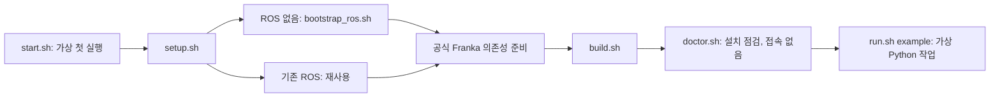
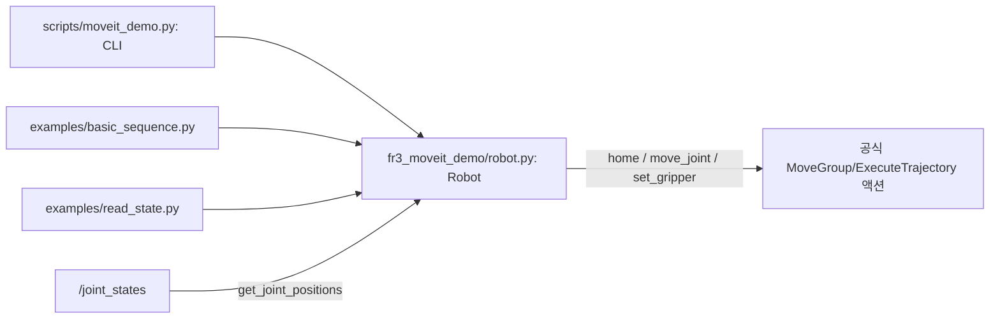
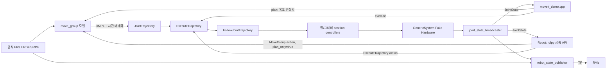
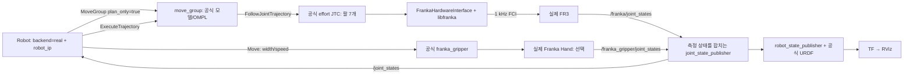
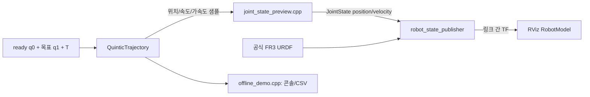
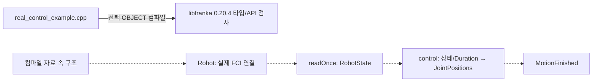

# FR3 Control Demo 아키텍처

코드가 어떤 데이터를 만들고 다음 단계가 무엇을 담당하는지 설명한다. 최초 진입점은 `./scripts/start.sh`이며 설치/빌드/점검 후 Python 가상 작업을 실행한다. 설치 후 기본 진입점은 `./scripts/run.sh`다. 실물은 native Ubuntu PC에서 별도 `real-*` 명령을 명시한다. 설치/실행은 [README](../README.md), 함수 호출은 [Python API](python-api.md), 실물 조건은 [실물 가이드](real-robot.md), 실제 수행 결과는 [검증 기록](validation.md)을 사용한다.

setup은 apt/rosdep과 공식 소스 다운로드를 담당한다. 소스가 이미 있으면 보존하고 고정 버전과 다르면 중단한다. ROS 최초 설치만 시스템 업데이트와 apt 저장소 설정을 수행한다. 실물 RT 커널/권한, 네트워크, Desk와 로봇 펌웨어는 사용자가 준비한다.

## 실행 모드와 공통 Python API

| 명령 | 서버 준비 | 사용자 동작 |
|---|---|---|
| `./scripts/run.sh` | Fake Hardware/RViz 시작 | Python으로 Joint 4 +0.1 rad |
| `./scripts/run.sh server` | Fake Hardware/RViz 시작 | 자동 이동 없음 |
| `./scripts/run.sh example` | Fake Hardware/RViz 시작 | basic_sequence.py의 정해진 호출 순서 |
| `./scripts/run.sh example-command` | 기존 서버 사용 | 같은 짧은 예제만 실행 |
| `./scripts/run.sh moveit-command` | 기존 서버 사용 | 지정한 팔/그리퍼 목표 실행 |
| `./scripts/run.sh moveit --language cpp` | Fake Hardware/RViz 시작 | 기존 C++ 클라이언트 실행 |
| `./scripts/run.sh real-server --robot-ip IP` | 공식 실물 팔 서버/RViz 시작 | 현재 자세 유지 제어, 자동 이동 목표 없음 |
| `./scripts/run.sh real-state --robot-ip IP` | 기존 실물 서버 사용 | 새 측정 상태 조회, 추가 이동 없음 |
| `./scripts/run.sh real-command --robot-ip IP --joint 4 --delta 0.01` | 기존 실물 서버 사용 | 명시한 단일 이동 실행 |

가상 server는 --no-rviz만 선택할 수 있다. example은 Python 전용이고 --duration을 각 단계에 전달한다. 가상 MoveIt은 기본 Python이며 --language cpp로 C++을 명시한다. real-server는 IP가 필수이며 선택적으로 --with-gripper/--no-rviz를 사용한다. real-command는 Python 전용이고 joint+delta, home, gripper-width 중 하나를 명시해야 한다. real 모드는 WSL을 거부하고 native Ubuntu RT 커널/권한을 확인한다.

예제는 `from fr3_moveit_demo import Robot`으로 설치된 공통 구현을 가져온다. home은 팔의 공식 ready 목표, move_joint는 현재값 기준 상대 각도, set_gripper는 전체 폭을 지정한다. get_joint_positions는 새 관절 상태를 dict로 읽으며 모션을 요청하지 않는다. 모든 이동 함수는 실행 완료/최종 상태 검사까지 기다리고 같은 호출 스레드에서 순서대로 사용한다.

Robot은 독립 ROS Context/Executor를 소유한다. 처음 제어하거나 상태를 조회할 때 서버에 연결하고 공식 모델을 캐시한다. with 문에서 사용하면 정상 종료/예외 때 통신 자원과 본인의 진행 중 목표를 정리한다. 기본 backend=fake는 GenericSystem을 요구한다. backend=real은 공식 FrankaHardwareInterface와 명시한 robot_ip의 서버 URDF 일치를 요구한다. Python 클래스는 FCI 소켓을 직접 만들지 않고 공식 ROS2 드라이버에 목표를 요청한다. Isaac Sim backend는 구현하지 않았다.

## MoveIt2: 계획한 궤적을 가상 컨트롤러로 실행

fake_moveit.launch.py는 공식 모델/MoveIt YAML을 읽어 노드를 시작한다. 실물 플러그인 선택 옵션은 없다. C++과 Python은 서버 모델을 읽고 가상 플러그인인지 확인한다. Python CLI와 설치된 예제는 Robot API를 재사용하고 C++은 MoveGroupInterface를 사용한다.

팔 모드에서는 현재 7개 관절 상태를 받은 뒤 상대 목표 또는 공식 ready를 설정한다. 그리퍼 모드는 공식 fr3_hand 그룹의 finger_joint1에 전체 목표 폭의 절반을 지정한다. finger_joint2는 공식 mimic 관계로 따라간다. MoveIt이 모델 충돌을 검사하며 경로를 계획한다. 요청 duration은 최소 시간으로 적용하고 계획을 빠르게 만들지 않는다. 실행 후 새 상태가 팔은 0.002 rad, 손가락은 0.0002 m 이내인지 확인한다.

공식 effort 컨트롤러는 GenericSystem에서 위치를 적분하지 않는다. 공식 파라미터를 읽어 command_interfaces만 position으로 바꾼 임시 파일을 spawner에 전달한다. 공식 URDF/SRDF는 hand=true로 읽는다. bringup에 없는 손가락 제어 인터페이스를 기존 GenericSystem에 메모리에서 추가하고, 가상 fr3_hand_controller의 FollowJointTrajectory로 한 손가락만 명령한다. 두 번째 손가락은 GenericSystem의 mimic 파라미터로 상태를 따라간다. 한 joint_state_broadcaster가 팔/손가락 9개 상태를 함께 발행한다. 실제 franka_gripper 노드는 실행하지 않는다. RViz에서 공식 현재 상태/계획 경로 표시를 유지하고 CLI에서 쓰지 않는 비활성 MotionPlanning 패널은 제외한다. 공식 소스/설정은 수정하지 않는다.

모터 동역학, 접촉, 물체 이동, 센서 잡음, 실제 로봇 지연은 재현하지 않는다.

## MoveIt2 실물: 공식 드라이버와 실제 측정 상태

real_moveit.launch.py는 고정한 공식 URDF/SRDF, 플래너 YAML과 effort 컨트롤러 YAML을 재사용한다. Fake의 position 변환, ready 초기값 주입과 손가락 가상 제어 인터페이스는 적용하지 않는다. 공식 실물 팔 JTC는 1000 Hz의 effort 명령으로 동작한다. Python은 실시간 루프의 매 주기를 계산하는 것이 아니라 계획/실행 목표를 요청한다.

실물 서버의 arm controller는 active로 시작해서 현재 자세 유지 제어를 수행한다. 시작 과정에 자동 이동 목표나 Home은 없다. 이를 완전한 읽기 전용 접속으로 설명하지 않는다. 상태 조회는 이 서버를 유지하며 추가 이동을 요청하지 않는다.

고정 upstream MoveIt launch는 load_gripper=false여도 gripper launch를 포함한다. 프로젝트의 실물 launch는 hand 선택에 따라 실제 드라이버를 포함하도록 바로잡는다. 팔만 연결하면 7개 상태를, 실제 Franka Hand를 포함하면 양쪽 손가락 측정 상태도 합친다. aggregator의 use_robot_description=false는 생성된 초기 관절값을 측정값처럼 내보내지 않게 한다. /joint_states 발행자는 aggregator 하나다.

실물 set_gripper는 공식 /franka_gripper/move를 호출한다. 목표 전체 폭과 duration으로 0.05 m/s 이하의 속도를 계산한다. grasp/force/자동 homing은 호출하지 않으며 손의 직접 Move는 MoveIt 손 경로 충돌 검사를 수행하지 않는다. 실물 정지 결과가 불확실하면 API는 같은 객체의 후속 이동을 막고 상태 조회/정지 재시도만 허용한다. 실제 FCI와 손의 동작/정지 성능은 Not Tested다. 준비와 단계별 실행은 [실물 가이드](real-robot.md)에 있다.

## Offline Preview: 계산한 자세를 재생

두 C++ 프로그램이 같은 trajectory_generator.cpp를 컴파일해서 사용한다. ROS 프리뷰는 wall timer에서 steady_clock 경과 시간으로 샘플을 조회한다. 콘솔은 수학적 시간 격자를 빠르게 계산하여 실제 시간 재생을 하지 않는다.

초기 15초간 ready를 표시하고 T초 동안 보간한 뒤 최종값을 계속 발행한다. JointState의 name/position/velocity는 7개 관절을 같은 순서로 표현하고 effort는 비운다. 가속도는 계산/검증에 사용하지만 JointState에는 가속도 필드가 없다.

SRDF ready와 URDF 위치/속도 제한이 계산기 상수와 같은지 발행 전에 확인한다. 양 끝 위치와 해석적 최대 속도/가속도를 검사한다. 충돌, jerk, FCI 위치 의존 제한은 검사하지 않는다.

상태를 구독해 제어하는 폐루프 제어기가 아니라 계산 결과만 내보내는 단방향 시각화다. move_group, ros2_control, franka::Robot은 실행하지 않는다.

## 실제 libfranka API를 설명하는 경로

점선은 설명 관계이며 실행 흐름이 아니다. 파일에 main이 없고 함수 첫 문장은 무조건 예외다. 전체 build.sh는 OBJECT로 API를 검사하며 실물 실행 파일을 만들지 않는다. Offline Preview는 이 객체/libfranka를 링크하지 않는다.

libfranka의 franka::Robot 생성자는 실제 네트워크 연결을 수행한다. 앞에서 설명한 Python Robot 클래스와 다르다. RobotState의 q는 측정값, q_d는 로봇 상태의 desired(목표) 관절 위치다. q_d와 처리 전 원시 명령을 동일하다고 가정하지 않는다. 콜백이 실제 period를 누적하고 JointPositions를 반환하며 MotionFinished가 종료를 표시한다. 이 기본 구조만으로 실물 안전성/FCI 적합성이 보장되지는 않는다.

## 파일별 읽는 순서

| 파일 | 확인할 내용 |
|---|---|
| `scripts/start.sh` | 설치 → 빌드 → 점검 → 가상 Python 예제 |
| `scripts/setup.sh` / `bootstrap_ros.sh` / `upstream.repos` | 최초 ROS apt 설치, 기존 설치 보존, 공식 dependency.repos |
| `scripts/build.sh` | 빌드 발견 경로, 계산기 테스트, API 컴파일 |
| `scripts/doctor.sh` | 소스/패키지/import, 선택 실물 PC의 RT/권한 검사. 접속 없음 |
| `scripts/run.sh` | 모드/옵션, 준비 검사, Ctrl+C 정리 |
| `ros2_ws/src/fr3_moveit_demo/launch/fake_moveit.launch.py` | 모델/플래너/가상 컨트롤러/RViz |
| `ros2_ws/src/fr3_moveit_demo/launch/real_moveit.launch.py` | 공식 실물 모델/effort 컨트롤러/측정 상태/선택 손 |
| `ros2_ws/src/fr3_moveit_demo/src/moveit_demo.cpp` | 현재 상태/목표/plan/execute/최종 검증 |
| `ros2_ws/src/fr3_moveit_demo/scripts/moveit_demo.py` | 기본 Python CLI, 입력을 Robot API 함수에 전달 |
| `ros2_ws/src/fr3_moveit_demo/fr3_moveit_demo/robot.py` | 상태/모델/목표/MoveGroup/ExecuteTrajectory/최종 검증의 공통 구현 |
| `ros2_ws/src/fr3_moveit_demo/examples/basic_sequence.py` | Home → 상대 이동 → 그리퍼 → Home 순서 수정 |
| `ros2_ws/src/fr3_moveit_demo/examples/read_state.py` | 모션 없이 상태 dict와 전체 그리퍼 폭 출력 |
| `standalone/libfranka_demo/trajectory_generator.h` | 이름/제한/공식 ready/계산기 계약 |
| `standalone/libfranka_demo/trajectory_generator.cpp` | 5차 보간과 전체 경로의 미분값 검사 |
| `standalone/libfranka_demo/offline_demo.cpp` | CLI와 콘솔/CSV 계산 |
| `ros2_ws/src/fr3_offline_preview/launch/preview.launch.py` | 공식 모델/단일 발행자/TF/RViz |
| `ros2_ws/src/fr3_offline_preview/src/joint_state_preview.cpp` | Timer/Publisher/최종 자세 유지 |
| `standalone/libfranka_demo/real_control_example.cpp` | 컴파일 전용 실제 API 구조 |
| `standalone/libfranka_demo/trajectory_tests.cpp` | 보간 경계/미분/제한 거부 검증 |

관절 번호는 CLI에서 1~7, 배열에서는 0~6이다. 단위는 rad, rad/s, rad/s², s다. 상대 이동은 MoveIt에서 수신한 현재값 기준이고 프리뷰에서는 매 실행의 ready 기준이다.

그리퍼의 위치/속도 단위는 m, m/s다. 전체 폭은 q_finger1 + q_finger2이며 0~0.08 m이다. 그리퍼 옵션이 없는 MoveIt 명령은 팔만 움직이고 현재 그리퍼 폭을 유지한다. Offline Preview는 기존 팔 전용 모델/계산기를 사용한다.

basic_sequence.py는 같은 Robot 객체로 home, move_joint(joint=4, delta=0.1), set_gripper(width=0.04), home을 차례로 호출한다. 마지막 home은 팔만 되돌리고 그리퍼 전체 폭 0.04 m는 유지한다. read_state.py는 get_joint_positions만 호출한다. 두 파일 모두 설치 후 ros2 run fr3_moveit_demo로 실행할 수 있으며 직접 ROS 명령에는 터미널 환경 source가 필요하다.

## 상태 발행과 실행 분리

/joint_states 발행자는 각 방식에서 하나여야 한다. Fake MoveIt은 joint_state_broadcaster, 실물은 측정 상태 aggregator, Offline Preview는 C++ 노드가 발행한다. JointState GUI를 추가하면 안 된다. 가상/실물/프리뷰 서버를 같은 ROS_DOMAIN_ID에서 동시에 실행하지 않는다.

입력/모델/현재 상태가 잘못되면 실행 전에 거부한다. 프리뷰 중 중복 발행자가 나타나면 중단한다. 다른 실험과 분리할 때는 서로 다른 ROS_DOMAIN_ID를 사용한다.
