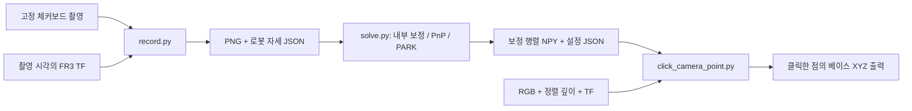

# FR3 팔 장착 D435i 캘리브레이션

**촬영 → 손눈 보정 → 좌표 확인**을 제공한다. Ubuntu 22.04 + ROS2 Humble 기준이며, MacGyvBot에서 쓰던 계산을 재사용했다. 보정 프로그램은 로봇을 자동으로 움직이지 않는다. 실제 FR3/D435i의 보정 정확도는 아직 검증하지 않았다.



## 1. 준비

| 준비물 | 확인할 것 |
|---|---|
| 제어 PC | [설치와 실물 연결](real-robot.md)이 완료된 Ubuntu 22.04 PC |
| D435i | USB 3 연결, 팔에 단단히 고정. 케이블이 관절 이동을 방해하지 않아야 함 |
| 체커보드 | [A4 PDF](../calibration/Checkerboard-A4-25mm-10x7.pdf)를 가로, **실제 크기 100%**로 인쇄. 용지 맞춤 해제 |
| 보드 규격 | 칸은 11×8개, **내부 코너는 10×7개**. 한 칸 25 mm를 자로 확인 |
| 보드 위치 | 평평한 판에 붙여 작업 공간에 고정. 촬영 중 보드를 옮기지 않음 |
| 장착 링크 | 예시는 `fr3_link8`. 촬영과 검증에서 같은 링크 사용 |

카메라와 브래킷을 장착한 뒤 실제 도구 질량과 무게중심 설정도 확인한다. `fr3_link8`, `fr3_hand`, TCP는 서로 다른 기준이다. 기존 MacGyvBot의 보정 행렬은 다른 로봇/장착 조건에서 측정했으므로 FR3에 사용하지 않는다.

기본 설치를 마친 다음 카메라 패키지와 보정 의존성을 준비한다.

```bash
cd ~/franka-demo
./scripts/start.sh --install-only --with-camera
```

설치/빌드/점검을 한 번에 수행하고 장치를 실행하지 않고 종료한다. 카메라는 선택 설치다. setup의 rosdep이 NumPy, OpenCV, cv_bridge, message_filters, tf2_ros를 준비하고 `--with-camera`가 D435i SDK/드라이버를 추가한다. 점검만 다시 하려면 `./scripts/doctor.sh --camera`를 실행한다. 패키지가 없으면 [공식 설치 안내](https://github.com/realsenseai/realsense-ros#installation)와 ROS Humble apt 저장소를 확인한다.

카메라 옵션은 USB 접근용 공식 udev 규칙도 준비한다. 설치 후 USB를 다시 연결하고 sudo 없이 카메라를 실행한다. 설치 범위와 기존 설정 보존은 [README](../README.md#4-설치-가이드)에 있다.

## 2. 촬영

**터미널 A — 로봇:** [실물 실행 절차](real-robot.md)에 따라 `real-server`를 준비한다. 연결된 로봇의 관절 상태에서 `robot_state_publisher`가 TF를 만들어야 한다. Fake Hardware의 자세와 실물 사진을 섞어서 보정하지 않는다.

**터미널 B — 카메라:**

```bash
source /opt/ros/humble/setup.bash
ros2 launch realsense2_camera rs_launch.py \
  enable_color:=true enable_depth:=true enable_sync:=true align_depth.enable:=true
```

RGB와 같은 픽셀 기준의 정렬 깊이를 발행한다. 촬영에는 RGB만 쓰고 마지막 좌표 확인에 깊이를 사용한다.

**터미널 C — 기록:** 저장소에서 새 데이터 폴더를 지정한다.

```bash
cd ~/franka-demo
source /opt/ros/humble/setup.bash
source ~/franka-demo/ros2_ws/install/setup.bash
python3 calibration/record.py \
  --output "$HOME/fr3_calibration/session01" --mount-frame fr3_link8
```

1. 보드 전체가 선명하게 보이는 자세로 이동하고 로봇을 **완전히 정지**한다.
2. 영상 창에서 **q**를 누른다. `SAVED sample_0001.png (1 pairs)`면 한 쌍 저장 완료다.
3. 다른 자세에서 반복한다. 서로 다른 회전축, 기울기, 거리에서 **15~25장**을 모은다. 같은 방향의 평행 이동만으로는 부족하다.
4. **ESC** 또는 Ctrl+C로 종료한다.

로봇 이동은 별도 터미널의 기존 `real-command`로 명시적으로 요청한다. 범위와 주변 공간을 확인하고 이동 완료 후 촬영한다. Desk의 수동 유도를 이용하려면 먼저 실행 중인 FCI 제어를 종료하고 해당 운용 모드로 전환해야 한다. FCI 제어 중 팔을 임의로 끌지 않는다. 기록 프로그램은 정지 여부를 자동 판정하지 않는다.

기존 출력 폴더는 거부한다. 재촬영은 `session02`처럼 새 폴더를 사용한다. 코너가 안 보이거나 영상 시각의 TF가 없으면 저장하지 않는다. 프레임/토픽 이름이 다르면 `--camera-frame`, `--color-topic`, `--info-topic`을 지정한다.

## 3. 계산

촬영을 마친 뒤 같은 ROS 환경을 source한 터미널에서 실행한다. 저장한 자료만 읽는다.

```bash
python3 calibration/solve.py \
  --data "$HOME/fr3_calibration/session01" --board 10 7 --square-mm 25
```

| 결과 | 의미 |
|---|---|
| `T_gripper2camera.npy` | 원본 파일명 유지. 실제 의미는 **카메라 점을 장착 링크로 옮기는 `T_mount_camera`**, 이동 성분 mm |
| `T_gripper2camera.json` | 기준 프레임, 단위, 추정한 K/D, 해상도, 사용 이미지와 오차 |

예상 출력은 `SAVED ...`, `T_mount_camera`, `camera RMS=... px`, `board consistency=... mm / ... deg`다. 숫자는 자료에 따라 달라진다. 코너 검출 최소 6장과 서로 다른 회전축을 요구하며 기존 결과는 덮어쓰지 않는다. 재계산은 `--output "$HOME/fr3_calibration/session01/retry.npy"`를 추가한다.

RMS는 영상의 재투영 오차, board consistency는 여러 자세에서 계산한 고정 보드의 베이스 위치 일치 정도다. **모두 학습 자료의 잔차다. 실제 좌표 정확도는 별도의 측정점으로 확인해야 한다.**

## 4. 클릭으로 좌표 확인

로봇 TF와 카메라가 실행 중인 상태에서 새 보정 파일을 지정한다.

```bash
python3 ros2_ws/src/fr3_moveit_demo/examples/click_camera_point.py \
  --calibration "$HOME/fr3_calibration/session01/T_gripper2camera.npy" \
  --translation-unit mm --mount-frame fr3_link8
```

왼쪽 클릭하면 `camera=[...] m, fr3_link0=[...] m`가 출력된다. ESC 또는 Ctrl+C로 종료한다. GUI 없이 한 점만 확인하려면 `--pixel 320 240`을 추가한다. 입력/TF가 없으면 대기하며 Ctrl+C로 중단할 수 있다.

동명 JSON이 있으면 추정한 K/D를 사용하고 프레임, 단위, 해상도 일치를 검사한다. JSON이 없는 기존 파일은 CameraInfo를 사용한다. 출력은 `/fr3/calibration/clicked_point`의 `geometry_msgs/PointStamped`다. RViz의 PointStamped 표시와 Fixed Frame `fr3_link0`로 확인할 수 있다.

```text
픽셀 + 정렬 깊이 → 카메라 optical XYZ
                  ↓ T_mount_camera (새 보정 결과)
                장착 링크 XYZ
                  ↓ T_base_mount (영상 시각의 TF)
                로봇 베이스 XYZ

p_base = T_base_mount @ T_mount_camera @ [x_cam, y_cam, z_cam, 1]
```

위치를 별도로 측정한 점 여러 개를 클릭해 오차를 기록한다. 팔 자세가 바뀌어도 고정 표적의 베이스 좌표가 유지되는지도 확인한다. 장착/기준 링크/해상도가 바뀌면 다시 보정한다. 출력은 자동 접근이나 집기 명령으로 연결되어 있지 않다.

## 5. 원본과 FR3 변경점

보정된 좌표로 작업을 이어가려면 [CV 창에서 집기/들기/원위치 놓기](pick-and-return.md)를 사용한다. 기존 좌표 확인 프로그램과 별도의 실행이며, 물체 치수와 작업대 높이/힘을 지정한다. 실물 이동은 `--execute`를 명시한 실행에서만 요청한다.

| 원본 | 유지한 계산과 변경점 |
|---|---|
| ZIP의 `data_recording.py` | 수동 저장 유지. 두산 ZYZ 자세 대신 영상 시각의 FR3 TF 4×4 행렬(m) 저장 |
| `handeye_calibration.py` | `findChessboardCorners` → `cornerSubPix` → `calibrateCamera` → `solvePnP` → `CALIB_HAND_EYE_PARK` 유지 |
| 원본 보드 점 생성 | 고정 `*25`를 `--square-mm`로 수정 |
| MacGyvBot `depth_projection.py`, `click_base_point.py` | 핀홀 투영과 보정/TF 행렬 곱 유지. 동기화, 단위/시각 검사와 왜곡 보정 추가 |

두산 제어, OnRobot 그리퍼와 원본 `test.py`의 자동 집기는 가져오지 않았다. 계산은 `fr3_moveit_demo/handeye.py`, 투영은 `fr3_moveit_demo/calibration.py`로 분리했다. 원본 프로젝트나 두산 SDK에 의존하지 않는다.

OpenCV 입력은 `mount → base` 로봇 자세와 `board → camera` PnP 자세, 출력은 `camera → mount`다. 이름만 보고 역행렬을 취하지 않는다. 계산에는 로봇 이동 성분을 m에서 mm로 통일하고 좌표 출력 때 다시 m로 바꾼다.

## 오류와 검증 범위

| 증상 | 확인 |
|---|---|
| 코너 검출 실패 | 내부 코너 10×7, 전체 보드 표시, 초점/반사/흔들림 |
| 회전축 부족 | 보드를 고정하고 여러 축으로 기울인 자세 추가 |
| TF 오류 | 장착 링크 이름과 영상 시각의 `fr3_link0 ← mount` TF |
| 영상 대기 | 토픽/QoS/시각/프레임. 좌표 확인은 정렬 깊이도 필요 |
| 결과가 1000배 차이 | 보정 mm, ROS TF/출력 m. 16UC1 깊이는 mm, 32FC1은 m |
| 프레임/해상도 불일치 | 촬영과 검증 설정 통일. 다른 조건의 보정 혼용 금지 |

동기화 차이는 최대 50 ms, 입력 유효 시각은 0.5초다. latest TF로 대체하지 않는다. 드라이버 TF를 덮어쓰거나 같은 카메라 TF를 별도로 발행하지 않는다.

```bash
# 저장소에서 실행. handeye/ROS 검사는 위 source 두 줄 필요
python3 tests/check_calibration.py
python3 tests/check_handeye.py
ROS_DOMAIN_ID=127 ROS_LOCALHOST_ONLY=1 python3 tests/check_calibration_ros.py
```

합성 자료로 단위/변환 방향, PARK 정답 복원, 영상부터 CLI 저장까지, ROS 기록/좌표 발행과 무효 입력 거부를 검사한다. **실물 촬영, FR3/D435i 보정 오차와 카메라 좌표를 이용한 로봇 이동은 Not Tested다.**

참고: [MacGyvBot 원본](https://github.com/MacGyvBot/macgyvbot/tree/9a8c208bba89eb542b73ffc52558b5b3ada05d19), [OpenCV Hand-Eye API](https://docs.opencv.org/4.x/d9/d0c/group__calib3d.html), [RealSense ROS](https://github.com/realsenseai/realsense-ros).
