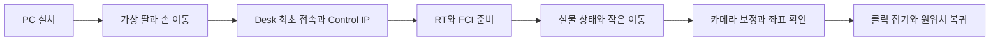

# 처음 사용하기

Ubuntu 22.04 **Desktop**에서 시작한다. 설치와 첫 가상 이동에는 FR3가 필요 없다. 실물 단계에는 FR3 운용 교육을 받은 현장 담당자와 함께 로봇 설치/상태를 확인한다. 초기 설치, RT 커널 준비와 보정은 별도 시간이 필요하다. 준비되지 않은 PC와 로봇을 5분 만에 설치하고 움직이는 절차는 아니다.

| 선택 | 제공하는 것 |
|---|---|
| [공식 franka_ros2 Humble](https://github.com/frankarobotics/franka_ros2/tree/humble) | 공식 실물 드라이버, 상태, 그리퍼, MoveIt 설정과 예제. 이것만으로 기본 제어 가능 |
| 이 프로젝트 | 위 공식 구성 + 통합 설치/실행, 쉬운 Python 호출, D435i 보정과 클릭 집기 작업 |

이 프로젝트는 공식 구성 위에 작업을 추가한다. 별도 FR3 드라이버나 IK를 작성하지 않는다. 공식 저장소를 직접 사용해도 RT, IP, Desk와 FCI 준비는 필요하다.



## 1. 설치와 첫 가상 이동

아래는 현재 저장소의 실행 경로다. [공식 환경에 작업 노드를 추가하는 구성안](official-addon.md)은 향후 설계로만 남겨두며 자동 설치 기능은 아직 제공하지 않는다.

Ubuntu 터미널에서 일반 사용자로 실행한다. 인터넷과 sudo 권한이 필요하다.

```bash
cd ~
sudo apt update
sudo apt install -y git
git clone https://github.com/LeeMin-hyeong/franka-demo.git
cd ~/franka-demo
./scripts/start.sh --install-only --with-camera
./scripts/run.sh example
```

설치는 ROS2 Humble, Franka/MoveIt/RViz, Python/C++ 도구와 D435i 드라이버를 준비한다. 카메라를 사용하지 않으면 `--with-camera`를 생략한다. 서버나 장치를 자동 연결하는 설치 명령은 아니다. 전체 변경 범위는 [설치 가이드](../README.md#4-설치-가이드)에 있다.

**성공:** 설치 점검 `OK` → RViz에 팔과 손 표시 → Home/Joint 4/손 40 mm/Home 이동 → `SEQUENCE COMPLETE`. Ctrl+C로 종료한다. 실패하면 첫 오류를 해결하고 같은 명령을 다시 실행한다. 기존 폴더가 있으면 다시 clone하지 않고 해당 폴더에서 진행한다.

이후 코드 변경은 `./scripts/build.sh`, 설치 점검은 `./scripts/doctor.sh --camera`다. 카메라를 설치한 뒤 USB를 다시 연결한다.

## 2. 실물 연결 전, Desk와 로봇 상태

| 구분 | 준비할 것 |
|---|---|
| 로봇 | 팔과 Control, 전용 케이블, 고정 베이스, 접지, 정지 장치, 현장 작업 공간 |
| PC | Ubuntu 22.04, PREEMPT_RT 커널, 실시간 권한, Control과 유선 직결 |
| Desk | 계정, 도구 질량/무게중심, 시스템 호환, FCI 라이선스/설치 |
| 카메라 집기 | 팔에 고정한 D435i, 공식 Franka Hand, 체커보드, 물체/작업대 실측 |

**주소를 모르면:** PC → 팔 X5 LAN → PC IPv4 자동(DHCP) → `https://robot.franka.de`. Desk에서 Control의 Shop Floor LAN을 설정한 뒤 PC 케이블을 **Control LAN**으로 옮긴다. 예를 들어 Control `172.16.0.2/24`, PC `172.16.0.1/24`를 직접 설정한다. `172.16.0.2`는 자동으로 주어지는 출고 주소가 아니다. [상세 연결과 RT 준비](real-robot.md#3-control-lan과-desk-준비)를 따른다.

| 상태 표시 | 다음 행동 |
|---|---|
| 흰색 | 고정은 대기/교시, 점멸은 부팅/종료/업데이트 등. Desk 확인 |
| 파란색 | 실행 준비/전환 상태. 색만으로 브레이크 해제나 FCI 활성 판단 금지 |
| 초록색 | 자동/협업 작업이 활성화되거나 시작될 수 있음. 현장 운용 절차 확인 |
| 노란색, 자홍색 | 경고/입력 충돌/확인 요청. Desk 메시지 해결 후 진행 |
| 빨간색 | 오류/위반/복구 상태. 새 동작 요청 중단 후 원인 확인 |

색과 점멸을 함께 보고 장비 버전의 [공식 매뉴얼 13절](https://franka.de/hubfs/Operating%20Manual%20Franka%20Research%203_5.9_R02216_1.2.2_EN.pdf?hsLang=en)을 우선한다. LED는 안전 확인 장치가 아니다. Desk에서 **브레이크, 운용 모드/제어권, 정지 입력, 경고/오류, 도구 설정, FCI 활성**을 확인한다. 준비한 PC에서 `./scripts/doctor.sh --real`을 통과해도 로봇 접속이나 실제 상태를 검사한 것은 아니다.

## 3. 준비된 로봇에서 첫 작은 이동

가상 서버와 Desk Task를 종료한다. [실물 가이드](real-robot.md)의 RT/권한, IP/버전/FCI 준비를 마친 뒤 실행한다. 아래 예시 IP는 앞 단계에서 직접 설정했을 때만 사용한다.

**터미널 A: 서버.** 시작하면 실제 현재 자세 유지 제어가 시작된다.

```bash
cd ~/franka-demo
./scripts/doctor.sh --real
./scripts/run.sh real-server --robot-ip 172.16.0.2
```

**터미널 B: 상태 확인 후 한 번 이동.** A는 그대로 둔다.

```bash
cd ~/franka-demo
./scripts/run.sh real-state --robot-ip 172.16.0.2
# 7개 관절값과 RViz가 실제 자세에 맞는지 확인한 뒤 실행
./scripts/run.sh real-command --robot-ip 172.16.0.2 --joint 4 --delta 0.01 --duration 5
```

**성공:** Planning SUCCESS → Execution SUCCESS → 새 측정 FINAL → 실제 Joint 4 움직임 관찰. 반복할 때마다 +0.01 rad가 누적된다. 실패하면 다음 동작을 보내지 않는다. 종료는 A에서 Ctrl+C 후 Desk의 FCI 해제/브레이크/Shutdown 절차를 따른다. 급박한 위험은 현장의 물리적 정지 장치로 대응한다.

## 4. 카메라와 클릭 집기

| 순서 | 사용할 안내 | 성공 기준 |
|---|---|---|
| 1 | [카메라 촬영](calibration.md#2-촬영) | RGB 영상과 `SAVED` 쌍 15~25개. 로봇이 정지했을 때 촬영 |
| 2 | [손눈 보정 계산](calibration.md#3-계산) | 새 NPY와 동명 JSON 생성, 오차 확인 |
| 3 | [클릭 좌표 확인](calibration.md#4-클릭으로-좌표-확인) | 베이스 XYZ와 별도 실측 비교. 팔 자세를 바꿔도 고정 표적 좌표 유지 |
| 4 | [가상 클릭 집기](pick-and-return.md#먼저-가상-검증) | 녹색 블록 중심 클릭, 8단계, `PICK AND RETURN COMPLETE` |
| 5 | [실물 집기](pick-and-return.md#실물에서-실행) | 실측 크기/작업대/힘 지정, 좌표부터 확인. 실제 들림/미끄러짐/원위치 관찰 |

실물 이동은 `--execute`가 있는 실행의 **다음 유효한 클릭**부터 시작한다. 블록을 집어 들었다가 같은 자리에 놓고 작업 시작 시의 팔 자세로 돌아온다. `set_gripper()`는 손 폭 이동, `grasp()`는 집기 요청이다. 가상 손가락/Scene 변화는 실제 물체를 잡았다는 증거가 아니다.

## 5. 원하는 작업 개발

처음에는 서버 구성을 바꾸지 않고 `examples/basic_sequence.py`를 복사해 작업 순서와 관절 목표만 수정한다. 파일 위치, 환경 source, 새 ROS2 워크스페이스 작성은 [Python API](python-api.md#새-작업을-만드는-두-경로)를 따른다. 실물 작업에는 `Robot(args=[], backend='real', robot_ip=...)`와 명시적인 동작을 사용한다.

| 이해할 코드 | 역할 |
|---|---|
| `examples/basic_sequence.py` | 사용자가 바꾸는 작업 순서 |
| `fr3_moveit_demo/robot.py` | 상태/제한 확인, MoveIt 계획 요청, 실행/결과 검사 |
| `examples/pick_and_return.py` | CV 클릭과 한 번의 작업 시작 |
| `fr3_moveit_demo/pick_place.py` | TCP 접근/하강/집기/상승/복귀와 Scene |
| `standalone/libfranka_demo/` | ROS 계획 없이 궤적을 직접 계산하는 C++ 학습 예제 |

패키지 코드 경로는 `ros2_ws/src/fr3_moveit_demo/` 기준이다. **MoveIt은 경로 계획**, **libfranka는 실제 FCI 통신/제어 API**다. 이 프로젝트의 Python은 ROS 목표를 보내고 공식 C++ 드라이버가 실물 통신을 맡는다. Offline Preview는 FCI 없이 계산한 관절값을 표시한다.

실제 FR3/Hand/D435i, 새 Ubuntu의 최초 설치, 초보 사용자의 현장 재현은 아직 검증하지 않았다. 확인한 범위와 남은 조건은 [초보자 관점 검토](beginner-review.md)에 구분한다.
