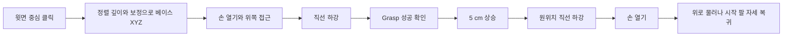

# 클릭으로 집기, 들어 올리기, 원위치에 놓기

CV 창에서 **직육면체 윗면의 중심**을 클릭하면 해당 물체를 집어 5 cm 들어 올렸다가 같은 자리에 놓고, 작업 시작 시의 팔 관절 자세로 돌아온다. 다른 장소로 옮기는 기능은 포함하지 않는다. Ubuntu 22.04, 공식 Franka Hand, 팔 장착 D435i를 기준으로 한다.



## 먼저 가상 검증

설치와 빌드를 마친 저장소에서 실행한다. 실물 서버와 다른 ROS_DOMAIN_ID를 사용한다.

**터미널 A: Fake Hardware와 RViz**

```bash
cd ~/franka-demo
export ROS_DOMAIN_ID=131
./scripts/run.sh server
```

**터미널 B: 합성 영상에서 물체 선택**

```bash
cd ~/franka-demo
export ROS_DOMAIN_ID=131
bash scripts/pick.sh --demo --execute
```

녹색 직육면체의 **정중앙**을 클릭한다. 합성 깊이와 알려진 보정 행렬을 사용한다. 실물 카메라로 구한 보정의 정확도를 검증하는 실행은 아니다. RViz의 MotionPlanning에서 Scene Geometry/Robot을 표시하면 받침대, 물체와 팔의 이동을 확인할 수 있다. GUI는 작업 중 `RUNNING`을 표시하며 추가 클릭을 무시한다. 한 번 완료하면 창이 닫힌다. `--execute`를 빼면 좌표만 확인한다.

GUI 없이 같은 좌표 변환과 전체 작업을 검사하려면 실행 중인 A 서버를 종료한 뒤 다음을 실행한다.

```bash
ROS_DOMAIN_ID=131 bash scripts/test_pick.sh
```

이 명령이 테스트용 Fake 서버를 만들고 종료한다. `CALIBRATED SELECT PASS`, `PICK CYCLE PASS`와 `ros2_ws/pick-report.json`을 확인한다. 팔 TCP의 상승/하강, Scene 물체 붙임/분리, 손가락 폭과 시작 관절 복귀를 검사한다. 실제 물리 접촉과 중력, 미끄러짐은 재현하지 않는다.

## 실물에서 실행

[실물 연결](real-robot.md)과 [새 FR3 캘리브레이션](calibration.md)을 먼저 완료한다. **실물 집기와 CV 클릭 실행은 아직 현장 검증하지 않았다.** 같은 로봇에 다른 클라이언트의 이동 명령을 동시에 보내지 않는다.

| 직접 확인할 값 | 의미 |
|---|---|
| 물체 크기 `--size X Y Z` | 베이스 X 방향 길이, Y 방향으로 집는 폭, 수직 높이. 단위 m |
| 작업대 `--table-z` | 로봇 베이스에서 실측한 작업대 상단 Z. 단위 m |
| `--force` | 물체 재질과 손가락에 맞게 선택한 집기 힘. 단위 N |
| 물체 방향 | 첫 버전은 베이스 X/Y 축에 평행하게 놓은 직육면체. 회전한 물체 자동 추정 없음 |
| 시작 자세 | 손은 비어 있어야 함. 카메라에서 물체가 보이고 접근 가능한 정지 자세. 복귀 목표는 이때의 관절값 |
| 주변 장애물 | 작은 30×30 cm 받침대와 선택 물체만 추가됨. 나머지 실제 작업대/장애물은 Planning Scene에 별도로 등록 |

아래 치수와 힘은 **예시**다. 40×30×50 mm 물체, 작업대 Z=0.20 m를 실제로 측정한 경우에만 해당 숫자를 사용한다. 윗면 Z에서 물체 높이를 뺀 값이 작업대 Z와 5 mm 이상 다르면 클릭을 거부한다. 투명/반사 물체, 옆면/배경, 손가락과 가까운 픽셀은 적절한 깊이를 주지 않을 수 있다. 맨 윗면 중심을 선택한다.

`--table-z`는 바닥에서 잰 책상 높이가 아니다. RViz의 TF에서 `fr3_link0`의 원점/축을 확인하고 그 기준의 작업면 높이를 별도로 측정한다. 클릭으로 계산한 Z를 그대로 정답으로 사용하면 보정 오차를 독립적으로 확인할 수 없다. 수평 작업면의 알려진 점들을 여러 자세에서 확인한 뒤 진행한다.

현재 작업의 입력 범위는 윗면 X=0.25~0.65 m, |Y|≤0.25 m, Z=0.10~0.50 m, 작업면 Z=0.03~0.45 m다. 물체 각 변은 10~100 mm이고 집는 Y 폭은 70 mm 미만이다. **베이스와 같은 Z=0인 작업면은 이 첫 버전에서 거부한다.** 가상 예제는 Z=0.20 m 받침을 사용한다. 이 범위는 프로그램 제한이며 실물 안전 영역이나 도달 가능성의 보증이 아니다. 범위 검사만 지워서 실물 배치를 맞추지 않는다.

**터미널 A: 실물 서버**

```bash
cd ~/franka-demo
read -rp 'Desk에서 확인한 Control FCI IP: ' ROBOT_IP
./scripts/doctor.sh --camera --real
./scripts/run.sh real-server --robot-ip "$ROBOT_IP" --with-gripper
```

**터미널 B: D435i**

```bash
source /opt/ros/humble/setup.bash
ros2 launch realsense2_camera rs_launch.py \
  enable_color:=true enable_depth:=true enable_sync:=true align_depth.enable:=true
```

**터미널 C: 먼저 좌표만 확인**

```bash
cd ~/franka-demo
read -rp '터미널 A와 같은 Control FCI IP: ' ROBOT_IP
bash scripts/pick.sh --backend real --robot-ip "$ROBOT_IP" \
  --calibration "$HOME/fr3_calibration/session01/T_gripper2camera.npy" \
  --size 0.04 0.03 0.05 --table-z 0.20 --force 20
```

새 FR3 NPY와 동명 JSON이 모두 필요하다. 보정 장착 링크는 `fr3_link8`, 작업 TCP는 `fr3_hand_tcp`, 출력 좌표는 `fr3_link0`다. 두 링크의 차이를 0으로 가정하지 않는다. 클릭한 XYZ와 별도 실측을 비교하고 주변 공간, 실제 도구 하중과 손가락 homing 상태를 확인한다. ESC로 좌표 창을 종료한다.

동일한 명령에 **`--execute`**를 붙이면 **다음 유효한 한 번의 클릭이 전체 실제 동작을 시작한다.**

```bash
bash scripts/pick.sh --backend real --robot-ip "$ROBOT_IP" --execute \
  --calibration "$HOME/fr3_calibration/session01/T_gripper2camera.npy" \
  --size 0.04 0.03 0.05 --table-z 0.20 --force 20 \
  --duration 5 --lift 0.05 --hold 1 \
  --report "$HOME/fr3_calibration/pick01.json"
```

완료 로그는 `PICK AND RETURN COMPLETE`다. 측정한 관절로 계산한 TCP의 목표 오차 3 mm/자세 오차 0.04 rad, 시작 관절 복귀 오차 0.002 rad를 확인한다. 이는 내부 FK 일치 검사이며 실제 카메라 보정 오차나 물체 유지/제자리 복원을 증명하지 않는다. **현장에서 물체가 실제로 들렸는지, 미끄러지지 않았는지, 원위치에 놓였는지를 별도로 관찰하고 기록한다.**

실제 그리퍼는 `/franka_gripper/grasp`를 쓰고 성공 응답과 폭 허용 오차를 확인한 뒤 상승한다. `Move`로 목표 폭을 맞춘 결과를 실제 집기 성공으로 바꾸지 않는다. 가상에서는 손가락 위치와 Scene의 attached 물체만 바꾼다.

ESC 또는 Ctrl+C는 실행 중인 목표의 정지/취소를 요청한다. 물리 비상정지는 별도로 준비한다. 실패 시 자동 재시도, 자동 손 열기와 자동 시작 자세 복귀를 수행하지 않는다. 실패가 물체를 든 상태에서 발생할 수도 있으므로 유지/정지 상태를 현장에서 확인한다. Scene과 보고서도 확인하고 다음 실행을 준비한다.

## 수정할 코드와 제한

| 파일 | 수정할 부분 |
|---|---|
| `examples/pick_and_return.py` | CV 선택, 물체 치수/힘 옵션, 단일 작업 큐와 중단 요청 |
| `fr3_moveit_demo/pick_place.py` | `run()`의 작업 순서, TCP 목표, 직선 접근/상승, Scene 붙임/분리 |
| `fr3_moveit_demo/robot.py` | `grasp()`의 실제 Grasp 액션과 상태/정지 검사 |

위 경로의 기준은 `ros2_ws/src/fr3_moveit_demo/`다. 수정 후 `./scripts/build.sh`를 실행한다. 예제는 `bash scripts/pick.sh`로 source 파일을 실행하므로 새 `ros2 run` 실행 권한에 의존하지 않는다.

직선 경로의 `fraction`이 1이 아니면 실행하지 않는다. 목표가 유효해도 접근 경로 또는 복귀 계획이 실패할 수 있다. 위에서 내려가는 작업만 제공하고 물체 yaw/치수 자동 추정, 임의 grasp 탐색, 미끄러짐 검출과 다른 장소로의 이송은 제공하지 않는다. 완료 뒤 Scene의 물체/받침대를 남기며 같은 ID가 있으면 다음 실행을 거부한다. 첫 검증은 한 번씩 하고 서버를 종료한 뒤 장면을 점검하여 새로 준비한다.

| 막힌 지점 | 해결 순서 |
|---|---|
| 영상이 나오지 않음 | B의 카메라 로그와 USB 3 연결 확인. `ros2 topic list`에서 color/aligned_depth_to_color/camera_info 확인 |
| 클릭이 거부됨 | 출력된 원인 확인. 윗면 중심, 깊이, 위 범위, 실측 물체 높이/작업면과 보정 프레임 확인 |
| 부분 Cartesian 경로 | 현재 자세에서 직선 접근 불가. 이동을 재촉하지 않고 가상 배치/주변 장애물을 확인 |
| Scene에 같은 ID가 있음 | 가상에서는 B 종료 → A Ctrl+C → A 서버 재시작 → B 재실행. 실물은 먼저 유지/정지 상태와 물체를 현장에서 확인 |
| 보고서 파일이 이미 있음 | 기존 파일을 보존하고 `pick02.json` 등 새 경로 사용 |

한 번에 하나의 작업 클라이언트만 실행한다. 서버가 필요하므로 B만 실행하거나 A를 먼저 종료하면 동작하지 않는다.

접근도 현재 관절 해를 유지하는 Cartesian 경로다. 장애물을 돌아가는 경로로 자동 대체하지 않는다. 시작 관절 자세 복귀는 MoveIt의 기존 관절 계획을 사용한다. 최종 관절값과 시작 TCP의 위치 차이를 함께 확인한다.

공식 참고: [Humble Cartesian Path](https://github.com/moveit/moveit_msgs/blob/humble/srv/GetCartesianPath.srv), [Humble FK](https://github.com/moveit/moveit_msgs/blob/humble/srv/GetPositionFK.srv), [Franka Grasp 액션](https://github.com/frankarobotics/franka_ros2/blob/3b50164eabbe2d461baca007bbbbe03c024387bd/franka_msgs/action/Grasp.action), [libfranka Gripper](https://frankarobotics.github.io/libfranka/0.20.4/classfranka_1_1Gripper.html).
