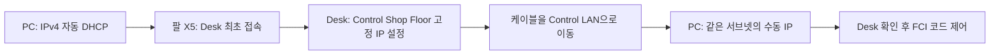

# 실제 FR3 연결과 첫 동작

이 문서는 컴퓨터를 실제 FR3의 Control에 연결하고, 측정 상태를 확인한 뒤 Python으로 관절 또는 Franka Hand 폭 이동을 요청하는 절차다. 기본 `start.sh`/`run.sh`는 가상 데모다. **실제 로봇 접속, 관절 이동, 그리퍼 이동과 정지 성능은 이 저장소 개발 환경에서 Not Tested다.** 소스/API/실행 구성 검증과 실물 검증은 [검증 기록](validation.md)에서 구분한다.

## 컴퓨터와 로봇의 기준

| 항목 | 현재 저장소의 실물 기준 |
|---|---|
| 제어 PC | native Ubuntu 22.04, Linux PREEMPT_RT 커널과 실시간 권한 |
| ROS | Humble, 이 저장소의 install을 source한 환경 |
| 공식 소스 | franka_ros2 Humble 고정 커밋 `3b50164eabbe2d461baca007bbbbe03c024387bd`, 패키지 버전 2.7.1 |
| 의존성 | 공식 dependency.repos의 libfranka 0.20.4, franka_description 2.8.1 |
| 로봇 시스템 | FR3 System Image 5.9.0 이상 계열, Robot/Gripper Server 10/3과 호환 확인 |
| 통신 | Control LAN에 직접 연결하는 유선 Ethernet, FCI 설치/활성화 |
| 손 | 실제 Franka Hand를 사용하는 경우에만 `--with-gripper` |

Humble은 Ubuntu 22.04를 기준으로 한다. 현재 라이브러리 조합은 공식 호환 범위에 맞지만 로봇 시스템 버전도 함께 맞아야 한다. 5.8/5.7의 로봇에 현재 libfranka를 그대로 연결하지 않는다. Desk의 Settings/Dashboard에서 시스템 버전을 확인하고, 새 버전 역시 최신 공식 호환표와 로봇 매뉴얼을 확인한다. 저장소는 펌웨어를 업데이트하거나 다운그레이드하지 않는다. [FR3 호환표](https://franka.de/fr3-compatibility-matrix), [Humble 의존성 호환](https://frankarobotics.github.io/docs/doc/franka_ros2_humble/franka_ros2/doc/compatibility_matrix.html)

실물 제어 루프는 낮은 지연과 안정적인 통신을 요구하므로 Ubuntu 제어 PC에서 실행한다. Python은 목표를 요청하고 공식 C++ 드라이버가 FCI 제어 루프를 담당한다. [FCI 시스템/네트워크 요구](https://frankarobotics.github.io/docs/doc/libfranka/docs/system_requirements.html)

## 1. 소프트웨어 설치

아래는 현재 저장소의 실행 경로다. [공식 환경에 작업 노드를 추가하는 구성안](official-addon.md)은 문서로만 남겨두며, 이번 변경에서 설치/실행 구조는 바꾸지 않는다.

Ubuntu에 Git도 없다면 설치한 뒤 복제한다. 일반 Ubuntu 사용자로 실행한다.

```bash
sudo apt update
sudo apt install -y git
git clone https://github.com/LeeMin-hyeong/franka-demo.git
cd franka-demo
./scripts/start.sh --install-only --with-camera
./scripts/doctor.sh
```

setup은 ROS가 없으면 공식 ROS2 Humble, MoveIt2, ros2_control과 Franka 의존성부터 준비한다. 시스템 패키지 추가/갱신이 발생하며 처음에 sudo 비밀번호를 요청할 수 있다. 기존 ROS와 소스는 재사용한다. 빌드 후 doctor에서 패키지와 Python import의 `OK`를 확인한다. 첫 오류를 해결하고 같은 명령을 다시 실행한다. 설치/빌드 자체는 로봇에 접속하지 않는다. 전체 변경 범위는 [README 설치 가이드](../README.md#4-설치-가이드)에 있다.

가상 동작부터 확인하려면 `./scripts/run.sh example`을 실행하고 종료한다. `start.sh`는 이 가상 단계까지 자동 수행하는 명령이며 실물 준비나 실행 명령은 아니다.

## 2. RT 커널과 현재 셸의 권한

실물 제어에는 PREEMPT_RT 커널이 필요하다. [Franka 공식 RT 커널 준비 안내](https://frankarobotics.github.io/docs/doc/libfranka/docs/real_time_kernel.html)에 따라 설치하고 재부팅한다. 커널 선택은 PC 관리자가 수행하며 setup은 자동으로 커널을 교체하지 않는다. RT 커널로 부팅한 뒤 확인한다.

```bash
uname -a
cat /sys/kernel/realtime
```

RT 커널 표시와 realtime 값 `1`을 확인한다. 일반 generic/lowlatency 커널만 설치한 상태는 프로젝트의 실물 실행 조건을 만족하지 않는다. Secure Boot 또는 그래픽 드라이버 문제로 RT 부팅에 실패하면 커널 설치 문서와 PC 설정을 확인한다.

Franka의 실시간 권한 예시를 별도 limits 파일에 적용한다. 아래 명령은 사용자 그룹과 시스템 권한 파일을 변경한다. 기존 파일이 있다면 먼저 내용을 확인해 필요한 값을 통합한다.

```bash
getent group realtime >/dev/null || sudo addgroup realtime
sudo usermod -a -G realtime "$USER"
sudo tee /etc/security/limits.d/99-franka-realtime.conf >/dev/null <<'EOF'
@realtime soft rtprio 99
@realtime hard rtprio 99
@realtime soft priority 99
@realtime hard priority 99
@realtime soft memlock 102400
@realtime hard memlock 102400
EOF
```

로그아웃 후 다시 로그인해 새 셸에서 확인한다. `memlock` 값의 단위는 KB다. root로 제어 프로그램을 실행해 권한 문제를 우회하는 대신 실제 제어 사용자에게 적용한다.

```bash
groups
ulimit -r
ulimit -l
./scripts/doctor.sh --real
```

rtprio는 99 이상, memlock은 102400 이상 또는 unlimited여야 한다. doctor는 native Ubuntu/RT 커널과 **현재 셸**의 한도를 확인한다. 설정 파일만 작성하고 이전 터미널을 계속 쓰면 실패할 수 있다. 이 점검은 IP 접속, FCI 준비와 실제 제어 성능을 검사하지 않는다.

## 3. Control LAN과 Desk 준비

로봇 설치/고정과 Arm-Control 케이블 연결, 하중과 장착물, 작업 공간과 정지 장치 준비는 해당 FR3 매뉴얼을 따른다. 외부 activation device와 물리적 emergency stop은 같은 장치로 간주하지 않는다. 소프트웨어 Ctrl+C도 물리적인 비상 정지를 대신하지 않는다. [FR3 매뉴얼](https://franka.de/documents), [FCI 로봇 준비](https://frankarobotics.github.io/docs/doc/libfranka/docs/getting_started.html)

**Control IP를 모르는 최초 접속:** PC를 팔 베이스의 X5 LAN에 연결하고 Ubuntu 설정 → 네트워크 → 해당 유선 연결 → IPv4를 자동(DHCP)으로 둔다. 로봇 부팅 후 `https://robot.franka.de`를 연다. 로봇 네트워크의 출고 기본 주소는 `192.168.0.1`이지만 기존 장비에서 변경됐을 수 있다. X5는 Desk 초기 설정용이며 아래 FCI 코드 제어용 포트와 다르다. [System 5.9 운용 매뉴얼, 3.1.3~3.1.4절](https://franka.de/hubfs/Operating%20Manual%20Franka%20Research%203_5.9_R02216_1.2.2_EN.pdf?hsLang=en)

새 장비의 First Start 화면에서 계정과 네트워크, Franka World 등록/동기화를 설정한다. 기존 장비는 관리자의 계정과 설정을 확인하고 초기화하지 않는다. Desk Settings의 네트워크에서 **Shop Floor LAN의 DHCP Client를 해제**하고 아래 Control 고정 주소를 적용한 뒤, PC 케이블을 Control LAN으로 옮긴다. PC 유선 IPv4를 수동으로 바꾸어 주소와 마스크를 입력한다. 로봇 전용 직결 LAN에는 게이트웨이/DNS를 지정하지 않고 설치용 인터넷은 별도 연결로 유지한다.



PC의 유선 LAN을 **Control의 LAN 포트**에 직접 연결한다. Arm 베이스 LAN 포트는 FCI 제어용 연결이 아니다. Control의 Shop Floor 네트워크와 PC를 같은 서브넷으로 설정한다. 공식 문서의 예시는 다음과 같으며 로봇의 출고 기본 주소라고 가정하지 않는다.

| 대상 | 예시 주소 |
|---|---|
| PC 유선 LAN | `172.16.0.1/24` |
| Control LAN, 아래 명령의 robot-ip | `172.16.0.2/24` |

Control의 네트워크는 Desk 설정에서, PC는 Ubuntu 유선 IPv4 설정에서 정한다. 실제 인터페이스 이름과 기존 인터넷 연결이 다르므로 setup은 네트워크를 바꾸지 않는다. PC 주소와 통신을 확인한다.

```bash
ip -br address
ping -c 4 172.16.0.2
```

자신의 Control 주소를 사용한다. 응답이 없으면 포트/케이블/서브넷/로봇 전원을 확인한다. ping 성공만으로 FCI의 실시간 통신 품질이 보장되지는 않는다. 고품질 직결 링크와 PC 지연을 별도로 확인한다. [네트워크 요구](https://frankarobotics.github.io/docs/doc/libfranka/docs/system_requirements.html)

브라우저에서 `https://172.16.0.2` 등 실제 Control 주소의 Desk를 연다. Settings → System → Installed Features에서 FCI 설치와 라이선스를 확인한다. 설치되지 않았으면 계정/컨트롤러 등록과 정식 FCI feature 설치가 필요하다. 매뉴얼에 따라 브레이크를 해제하고 외부 activation device 상태를 확인한 뒤 **Activate FCI**를 선택하고 FR3의 확인 팝업을 처리한다. FCI 활성 중 Desk Apps를 동시에 실행하지 않는다. [공식 Desk/FCI 절차](https://frankarobotics.github.io/docs/doc/libfranka/docs/getting_started.html), [FCI 제어 구조](https://frankarobotics.github.io/docs/overview.html)

## 4. 서버 연결 후 상태 확인

같은 저장소의 터미널 A에서 실행한다. 아래부터는 실제 로봇과 통신한다.

```bash
./scripts/run.sh real-server --robot-ip 172.16.0.2
```

서버는 공식 실물 URDF, MoveIt 플래너, effort JointTrajectoryController와 FrankaHardwareInterface를 시작한다. **현재 자세 유지 제어가 시작된다.** 자동 Home 또는 상대 이동 목표를 보내지는 않지만, 완전한 읽기 전용 프로세스는 아니다. 실제 현재 자세를 받아 RViz에 표시한다. 가상 ready 값을 실물 초기 자세로 주입하지 않는다.

Franka Hand를 실제 사용한다면 A의 서버를 종료하고 다음처럼 시작한다. 손이 없거나 다른 그리퍼라면 `--with-gripper`를 사용하지 않는다. 현재 버전은 타사 그리퍼 드라이버를 제공하지 않는다.

```bash
./scripts/run.sh real-server --robot-ip 172.16.0.2 --with-gripper
```

`--no-rviz`는 서버 시작 옵션이다. 같은 `ROS_DOMAIN_ID`에 기존 가상 서버와 실물 서버를 중복 실행하지 않는다. 명령은 같은 PC의 터미널 B에서 순서대로 보낸다.

```bash
./scripts/run.sh real-state --robot-ip 172.16.0.2
```

상태 조회는 추가 이동 목표를 보내지 않고 팔 7개 위치를 rad로 출력한다. 손을 포함한 서버에서는 손가락 2개 위치와 전체 폭도 m로 출력한다. IP는 A에서 지정한 주소와 정확히 일치해야 한다. 서버 URDF가 real 플러그인이 아니거나 다른 IP면 요청을 거부한다. RViz 실제 자세와 측정 상태가 로봇의 현재 모습에 맞는지 확인한다.

실물 API는 집계 `/joint_states`와 함께 팔의 `/franka/joint_states`, 손 사용 시 `/franka_gripper/joint_states`에서 새 측정을 기다린다. 각 소스의 발행자가 하나이고 측정 시각과 수신 시각이 모두 최근 1초 이내여야 한다. 집계기가 오래된 값을 새 timestamp로 반복 발행해도 실물 측정으로 인정하지 않는다. 반환 위치와 최종 목표 검사에는 raw 측정값을 사용하며 실행 직전에 다시 확인한다.

## 5. 작은 관절 이동과 Home

작업 공간과 로봇 상태를 확인한 후 B에서 한 명령을 보낸다. 다음 예제는 현재 위치에서 Joint 4를 +0.01 rad 바꾸며 다른 관절 목표는 현재값을 유지한다. 작은 이동량도 실물 안전성의 보증은 아니다.

```bash
./scripts/run.sh real-command --robot-ip 172.16.0.2 --joint 4 --delta 0.01 --duration 5
```

START/GOAL, Planning 결과, Execution 결과와 새 측정 FINAL 값을 확인한다. 계획 실패/실행 오류/최종 위치 불일치는 실패로 반환하고 다음 작업을 진행하지 않는다. duration을 생략한 실물 CLI 기본값은 5초이며 팔은 계획을 빠르게 만들지 않고 최소 시간으로 적용한다. 원래 계획이 더 길면 그 시간을 유지한다.

`real-command`는 `--joint`와 `--delta`를 함께 지정하거나 `--home`, `--gripper-width` 중 하나를 명시해야 한다. 일반 `moveit-command`의 기본 +0.1 rad는 실물에 적용되지 않는다. 서로 다른 명령 클라이언트를 동시에 실행하지 않는다.

```bash
./scripts/run.sh real-command --robot-ip 172.16.0.2 --home --duration 5
```

Home은 공식 SRDF `ready`인 `[0, -π/4, 0, -3π/4, 0, π/2, π/4]` rad로 이동한다. 모든 팔 관절이 이동할 수 있으며 실제 주변 물체는 MoveIt Planning Scene에 자동 등록되지 않는다. 초기 연결 직후 Home으로 강제 이동하지 않는다. 그리퍼 폭은 유지한다.

## 6. 실제 Franka Hand의 폭 이동

`--with-gripper`로 시작한 서버에서 자유 공간의 전체 폭을 지정한다.

```bash
./scripts/run.sh real-command --robot-ip 172.16.0.2 --gripper-width 0.04 --duration 5
```

표준 손의 전체 모델 폭은 0~0.08 m다. 0.04 m는 40 mm 전체 폭이고 각 손가락 위치는 0.02 m다. API는 **`/franka_gripper/move`의 `franka_msgs/action/Move`**를 호출하고 실제 폭 변화와 duration으로 `speed = min(0.05, abs(target-current)/duration)` m/s를 계산한다. duration은 속도 계산 기준이며 완료 시간을 정확히 보장하지 않는다. 모델 범위 안이어도 실제 장착 손가락이나 측정 최대 폭에 따라 드라이버가 거부할 수 있다. [고정 소스의 Move 액션](https://github.com/frankarobotics/franka_ros2/blob/3b50164eabbe2d461baca007bbbbe03c024387bd/franka_gripper/src/gripper_action_server.cpp), [Move 메시지](https://github.com/frankarobotics/franka_ros2/blob/3b50164eabbe2d461baca007bbbbe03c024387bd/franka_msgs/action/Move.action)

이 폭 이동 명령은 grasp/force 제어와 자동 homing을 수행하지 않는다. 물체 집기는 별도 [CV 선택 집기 작업](pick-and-return.md)에서 공식 Grasp를 사용하며 실제 검증은 아직 수행하지 않았다. homing이 필요한 상태이면 제조사 매뉴얼에 따라 사용자가 먼저 수행한다. homing 자체가 손가락을 움직이므로 접속 과정에 숨겨 실행하지 않는다. 직접 Move는 MoveIt의 손 경로 충돌 검사를 거치지 않는다. 폭 목표에 닿지 않거나 접촉/오류가 발생하면 실패로 다룬다.

Franka 공식 문서의 일부 예시는 `/fr3_gripper`이지만 현재 고정 launch 소스의 노드명은 `franka_gripper`다. 이 저장소는 실제 고정 소스의 이름을 사용한다.

## Python 작업 파일로 확장

실물 서버 A를 유지하고 B에서 환경을 source한 다음 자신의 파일을 실행한다. 먼저 상태만 읽고, 동작이 필요한 줄을 명시한다.

```bash
source /opt/ros/humble/setup.bash
source ros2_ws/install/setup.bash
python3 my_real_task.py
```

```python
from fr3_moveit_demo import Robot

with Robot(backend='real', robot_ip='172.16.0.2') as robot:
    positions = robot.get_joint_positions()
    print(positions['fr3_joint4'])
    robot.move_joint(joint=4, delta=0.01, duration=5.0)
```

기본 `Robot()`은 fake 전용이고 실물 서버를 거부한다. 작업 파일은 같은 호출 스레드에서 순서대로 수행한다. 함수를 추가할 위치와 반환값은 [Python API](python-api.md)를 참고한다. 일반 가상 sequence를 ROS 파라미터로 real로 바꿔 한꺼번에 재생하는 방식으로 실물 첫 동작을 시작하지 않는다.

## 종료와 오류

정상 종료는 서버 A에서 Ctrl+C다. 작업 클라이언트 B의 Ctrl+C는 자신의 실행 목표에 소프트웨어 정지/취소를 요청한다. 실제 정지 완료 응답을 받지 못하면 경고를 표시하며 정지 성공으로 간주하지 않는다. 같은 Robot 객체의 후속 이동은 막고 상태 조회와 정지 재시도만 허용한다. 새 작업 프로세스로 이 오류를 우회하지 말고 실제 상태와 현장 정지 절차를 확인한다. 물리적 정지 장치는 로봇 매뉴얼과 현장 구성을 따른다. 자동 오류 복구나 이동 재시도는 제공하지 않는다.

실행 실패 결과도 정지 확인으로 처리하지 않는다. 실물 손은 목표 취소와 별도의 `/franka_gripper/stop` Trigger 서비스로 정지를 요청한다. 이미 ABORTED된 목표에도 서비스가 필요할 수 있다. 목표의 종료와 서비스 성공 응답을 모두 받아야 소프트웨어 차단을 해제하며, 목표 수락이 아직 미확인인 경우는 서비스 성공만으로 해제하지 않는다. 서비스 성공은 공식 드라이버의 stop 응답이며 물리적 정지 성능 검증은 아니다.

| 증상 | 확인할 사항 |
|---|---|
| RT/권한 검사 거부 | Ubuntu 제어 PC, RT 커널 부팅, 새 로그인 셸의 ulimit 확인 |
| Connection timeout | Control LAN/IP, FCI 설치와 활성화, 로봇 준비 상태 |
| UDP receive Timeout | 유선 연결과 UDP 방화벽, 실제 네트워크 품질 |
| Incompatible Library Version | Desk 시스템 버전과 Robot Server 호환, 현재 고정 libfranka 요구 조건 |
| communication_constraints_violation | 제어 PC와 링크 지연/패킷 손실 확인. 자동 재시도로 덮지 않음 |
| Current State 없음 또는 가상 값 | controller/측정 토픽 확인, 중복 발행자 제거, 별도 JointState GUI 실행 금지 |
| 실물 손 목표 실패 | 장착한 손, homing/최대 폭, driver result.error 확인. force로 재시도하지 않음 |
| MoveIt/RViz 종료 충돌 | 기존 Humble upstream 종료 오류와 실물 제어 결과를 구분. [검증 기록](validation.md) 참조 |

Franka의 [공식 문제 해결](https://frankarobotics.github.io/docs/troubleshooting.html)을 함께 확인한다. 시스템 설치/import/가상 제어 성공과 실제 FCI 연결/동작 성공은 별개이며, 처음 연결한 로봇에서 실제 상태와 명령 결과를 확인해야 한다.
