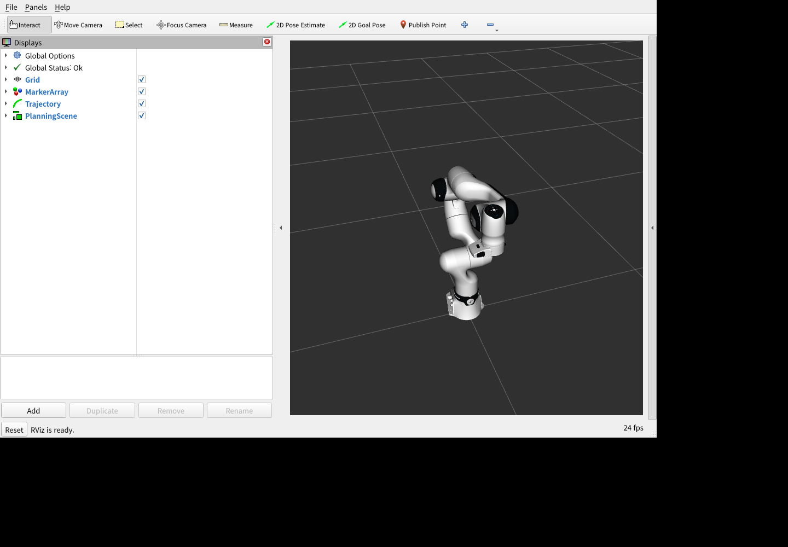
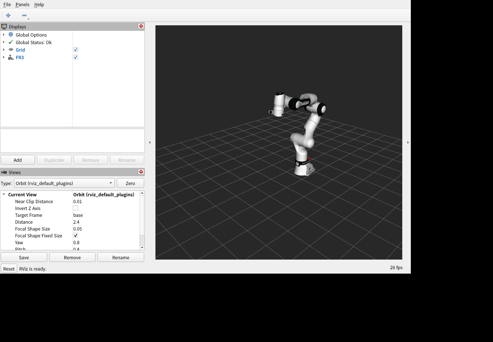

# 검증 기록

2026-10-10 KST에 기존 WSL2 Ubuntu 22.04 환경에서 수행했다. 성공한 항목과 남은 문제를 구분한다. 실물 FR3나 FCI 연결은 사용하지 않았다.

## 환경과 소스

| 항목 | 검증 환경 |
|---|---|
| OS | WSL2 Ubuntu 22.04.5 LTS, x86_64 |
| 컴파일러 / CMake | GCC 11.4.0 / CMake 3.22.1 |
| ROS2 | Humble, `/opt/ros/humble` |
| MoveIt2 | Ubuntu apt 패키지 2.5.10 |
| rclcpp / RViz | 16.0.21 / 11.2.29 |
| Python MoveIt 클라이언트 | rclpy 3.3.21 / moveit_msgs 2.2.1 |
| franka_ros2 | Humble, `3b50164eabbe2d461baca007bbbbe03c024387bd` |
| franka_description / libfranka | 2.8.1 / 0.20.4, 공식 dependency.repos 기준 |
| GUI 검증 | Xvfb와 소프트웨어 OpenGL에서 실제 RViz2 렌더링 |

외부 소스는 `ros2_ws/src/vendor`에 다운로드했다. 공식 소스에 수정하지 않았고 다른 사용자의 기존 워크스페이스를 사용하거나 삭제하지 않았다. 데모 overlay의 상위 환경은 `/opt/ros/humble`이다.

## 설치와 빌드

```bash
./scripts/setup.sh
./scripts/build.sh
```

기존 ROS Humble 환경에서 apt 설치와 rosdep 의존성 설치를 실제 수행했다. 설치 스크립트의 관리자 작업은 WSL root로 검증했다. 신규 Ubuntu에 ROS 자체를 처음 설치하는 README 4.2 전체 절차는 실행하지 않았다.

전체 빌드는 필요한 공식 패키지와 데모 총 11개를 완료했다. standalone 계산기, 테스트 프로그램, `real_api_compile_check` OBJECT도 빌드했다.

```text
Summary: 11 packages finished
[100%] Built target real_api_compile_check
100% tests passed, 0 tests failed out of 5
빌드 완료. 실제 Robot 연결은 수행하지 않았습니다.
```

| CTest | 결과 | 확인한 내용 |
|---|---|---|
| quintic_trajectory | PASS | 정확한 시작/끝 위치, 시간 경계, 0인 끝점 속도/가속도, 단조성, 유효하지 않은 입력과 제한 거부 |
| offline_default | PASS | 기본 Joint 4, +0.1 rad, 3초 계산 |
| offline_custom_period | PASS | 정수 샘플 간격으로 나누어떨어지지 않는 이동 시간에서도 정확한 마지막 샘플 |
| reject_joint_limit | PASS | 위치 제한 초과 시 비정상 종료 코드 |
| reject_short_duration | PASS | 과도한 속도/가속도가 필요한 이동 거부 |

이 테스트는 수학적 계산과 입력 검증을 확인한다. 실시간 타이머 정확도나 로봇의 동역학을 검증하는 테스트가 아니다.

## MoveIt2 Fake Hardware

아래 팔 전용 화면과 수치는 그리퍼 추가 전의 검증이다. 현재 그리퍼 포함 구성은 별도 추가 검증 절에 기록한다.

```bash
./scripts/run.sh moveit --no-rviz
# 스택이 실행 중인 다른 터미널
./scripts/run.sh moveit-command --home
./scripts/run.sh moveit-command --joint 4 --delta 100
```

실제 run.sh로 스택 준비, 현재 상태 수신, 계획과 3초 모의 실행을 확인했다. 기본 이동의 Joint 4 시작값은 -2.356194 rad, 목표는 -2.256194 rad, 수신한 최종값은 -2.256171 rad이었다. 모든 최종 관절이 목표에서 0.002 rad 이내였다. Home 복귀도 성공했고 delta=100은 계획 전에 거부했다.

최종 스크립트의 추가 종료 검사에서도 이동에 성공했다(Joint 4 최종 -2.256124 rad). 실행 스크립트에 SIGINT를 한 번 전달한 뒤 종료 코드 130을 반환했고, 소유한 실행 중 자식 프로세스 수는 0이었다. 아래 upstream 소멸자 문제는 그대로 재현됐다.

RViz를 켠 공식 설정 재사용 launch와 `moveit-command --joint 4 --delta 0.1 --duration 3`도 실행했다. 해당 실행의 Joint 4 최종값은 -2.256238 rad이며 계획, 컨트롤러 실행, 실행 후 새 JointState, TF 수신이 성공했다. RViz Global Status는 Ok였다.

- [x] C++ ROS 패키지 빌드
- [x] GenericSystem Fake Hardware 및 position 컨트롤러 active
- [x] 공식 FR3 URDF와 ready 초기 자세 로딩
- [x] 7개 Current Joint State 수신 및 목표 제한 검사
- [x] MoveIt Planning 성공
- [x] FollowJointTrajectory 실행 성공
- [x] 실제 발행된 최종 관절 상태와 목표 비교
- [x] RViz 초기/최종 자세 표시와 TF 수신
- [x] Home 복귀와 제한 초과 거부
- [ ] upstream MoveIt/RViz의 오류 없는 종료: 아래 알려진 문제 참조

시작 자세:



Joint 4를 +0.1 rad 이동한 최종 자세:


## C++과 Python RViz 데모 추가 검증

Python 실행 파일을 추가한 뒤 `fr3_moveit_demo` 패키지를 빌드하고 설치했다. C++ 실행 파일도 최신 소스로 다시 컴파일했다. Python은 공식 Humble의 MoveGroup/ExecuteTrajectory 액션을 사용하며 별도 pip 패키지를 설치하지 않았다.

```bash
./scripts/run.sh moveit --language python --no-rviz
./scripts/run.sh moveit-command --language python --home
./scripts/run.sh moveit-command --language python --joint 4 --delta 100
```

Python의 기본 이동은 Joint 4가 -2.356194 rad에서 -2.256117 rad로 이동했다. 계획/실행 성공을 따로 확인하고 모든 최종 관절을 목표와 비교했다. Home 최종 Joint 4는 -2.356117 rad이었다. delta=100은 계획 전에 거부했고 JointState를 받지 못하는 조건에서도 오류 코드 1로 실행을 거부했다. 같은 스택에 C++ 클라이언트를 이어 실행해 현재값 기준 상대 이동도 확인했다(C++ 최종 Joint 4 -2.456073 rad).

RViz를 켠 상태에서 다음 Python 명령도 실행했다.

```bash
./scripts/run.sh moveit-command --language python --joint 4 --delta 0.1 --duration 3
```

해당 실행은 공식 ready에서 시작했으며 목표 Joint 4는 -2.256194 rad, 수신한 최종값은 -2.256103 rad이었다. 계획, 3초 Fake Hardware 실행, 새 JointState와 TF 수신이 성공했다. RViz Global Status는 Ok였다.

- [x] Python 구문 검사와 ROS 패키지 실행 파일 설치
- [x] 실제 run.sh의 --language python 선택
- [x] Python MoveIt 계획과 별도 실행
- [x] 목표와 최종 수신 상태 비교
- [x] Home 복귀, 제한 초과 거부, Current State 미수신 거부
- [x] 같은 Fake Hardware 스택에서 C++ 클라이언트 실행
- [x] Python RViz 초기/최종 자세 표시 및 TF 수신
- [x] 잘못된 --language 값과 Preview의 언어 옵션 거부
- [x] Python 실행 중 SIGINT의 궤적 정지와 종료 코드 130

15초 이동을 실행하는 Python 클라이언트에 SIGINT를 한 번 전달했다. 공식 MoveGroupInterface.stop()과 같은 `/trajectory_execution_event`의 `stop` 이벤트를 요청하고 MoveIt의 PREEMPTED 결과로 정지를 확인했다. 해당 이벤트는 공식 GenericSystem 모델을 확인하고 본인이 보낸 Execution 목표가 진행 중일 때만 발행한다. 로그는 `Fake trajectory stop confirmed by MoveIt (PREEMPTED).`이며 클라이언트는 130으로 종료했다. Humble의 실행 액션은 취소 처리만으로 정지가 지연될 수 있어 정지 이벤트와 취소 응답을 구분해 확인한다.

시작 자세:


Joint 4를 +0.1 rad 이동한 최종 자세:


Python 클라이언트가 성공한 뒤에도 기존 MoveIt/RViz 종료 소멸자 오류는 재현됐다. 클라이언트 언어와 별개의 알려진 서버/시각화 종료 문제다.

## 가상 그리퍼 추가 검증

공식 description 2.8.1의 Franka Hand URDF/SRDF를 재사용했다. 팔과 같은 GenericSystem에 손가락 인터페이스를 추가하고 실물 franka_gripper 노드 없이 가상 fr3_hand_controller를 실행했다. C++ 단일 패키지 빌드와 Python/launch 문법 검사가 통과했다. 새로운 시스템 패키지는 설치하지 않았다.

RViz를 켠 첫 터미널과 실행 중인 스택의 추가 명령을 순서대로 검증했다.

```bash
./scripts/run.sh moveit --language cpp --gripper-width 0.08 --duration 3
# 다른 터미널에서 하나씩 실행
./scripts/run.sh moveit-command --language python --gripper-width 0 --duration 3
./scripts/run.sh moveit-command --language python --gripper-width 0.04 --duration 3
./scripts/run.sh moveit-command --language cpp --gripper-width 0 --duration 3
./scripts/run.sh moveit-command --language cpp --joint 4 --delta 0.1 --duration 3
./scripts/run.sh moveit-command --language python --home --duration 3
```

| 명령 | 실제 JointState 최종 전체 폭 [m] | 확인 결과 |
|---|---:|---|
| C++ 열기 0.08 | 0.07998084 | 계획/실행 성공, 양쪽 mimic, 팔 자세 유지 |
| Python 닫기 0 | 0.00001774 | 계획/실행 성공, RViz 닫힌 모습 |
| Python 열기 0.04 | 0.03999194 | 계획/실행 성공, 중간 폭 |
| C++ 닫기 0 | 0.00001981 | 계획/실행 성공, 양쪽 최종 목표 확인 |
| C++ 팔 Joint 4 +0.1 | 0.00001981 | Joint 4 -2.25624020 rad, 그리퍼 폭 유지 |
| Python 팔 Home | 0.00001981 | Joint 4 -2.35627314 rad, 그리퍼 폭 유지 |

계획/실행 결과만 사용하지 않고 별도 검증 구독자로 새 JointState를 받았다. 팔 7개와 손가락 2개, 총 9개 이름/유한 위치, 한 발행자, 양쪽 손가락 일치, 전체 폭의 목표 오차 0.0002 m 미만을 확인했다. 그리퍼 이동 동안 7개 팔 관절의 ready 유지도 검사했다. RViz Global Status는 Ok이며 robot_state_publisher의 fr3_leftfinger/fr3_rightfinger TF를 수신했다.

실행된 C++ 열기와 Python 닫기 화면:


스크립트와 별도로 두 클라이언트에 `gripper_width:=0.081`을 직접 전달해 모델 제한 검사를 확인했다. 둘 다 계획 전에 공식 joint bounds 오류와 종료 코드 1을 반환했고 초기 폭 0.07 m와 팔 ready가 유지됐다. 첫 검사에서 테스트용 wait_timeout=5.0의 모델 응답 timeout이 발생해 제한 거부를 판정하지 못했다. 기본 30초 설정으로 해당 검사만 다시 수행해 양쪽 제한 거부와 손가락 TF 검증을 통과했다.

- [x] 공식 그리퍼 형상, 제한, mimic과 초기 open 상태 로딩
- [x] 팔/손가락 컨트롤러와 한 joint_state_broadcaster active
- [x] C++과 Python의 가상 열기/닫기 및 최종 실제 폭 검사
- [x] RViz 그리퍼 표시, 양쪽 손가락 TF와 대칭 상태
- [x] 그리퍼 이동 시 팔 유지, 팔 이동 시 그리퍼 폭 유지
- [x] 두 클라이언트에서 전체 폭 0.081 m 거부
- [x] CLI 음수/비수치/범위 초과, 팔 옵션 동시 지정, Preview 그리퍼 옵션 거부
- [x] 실제 그리퍼 드라이버/API/네트워크 연결 없이 실행
- [ ] 물체 접촉, grasp와 힘 제어: 구현하지 않음

기존 MoveIt/RViz 종료 소멸자 오류는 그리퍼 구성에서도 재현됐다. 새 그리퍼 동작과 별개의 알려진 종료 문제이며 아래 한계를 유지한다. 이전 Python 팔 이동의 SIGINT 정지 검증은 앞 절에 기록했으며 그리퍼 실행 중 정지는 이번 추가 검증에 포함하지 않았다.

## Python 기본 구성과 공통 API 검증

Python을 기본 클라이언트로 바꾸고 `Robot` 모듈을 ament_cmake_python으로 설치했다. 변경한 fr3_moveit_demo 패키지의 colcon 빌드/설치와 API, CLI, 두 예제의 문법 검사가 통과했다. 기존 C++ 실행 파일을 함께 유지했다. ament_cmake_python은 검증 환경에 이미 설치되어 있어 이번 변경으로 apt 설치를 다시 수행하지 않았다.

인자 없는 실제 기본 명령을 RViz와 실행했다.

```bash
./scripts/run.sh
# 다른 터미널에서, 위 스택을 유지한 채
./scripts/run.sh example-command --duration 1
```

Python 기본 경로의 Joint 4 최종값은 -2.25609656 rad였다. 별도 상태 구독으로 팔 7개와 손가락 2개, 한 발행자, 목표 오차와 공식 mimic을 확인했다. 같은 RViz에서 Python API 예제를 실행한 뒤 팔은 ready, 전체 그리퍼 폭은 0.04001603 m였다. 실제 RViz Global Status는 Ok였다.


서버만 준비하는 `./scripts/run.sh server --no-rviz`에서 자동 이동이 없고 초기 ready/전체 폭 0.07 m가 유지되는 것도 확인했다. 설치된 모듈을 저장소 밖의 작업 디렉터리에서 import한 뒤 **같은 Robot 객체**로 Home → Joint 4 +0.1 → -0.1 → 그리퍼 0/0.08/0.04 m → Home을 수행했다. 각 메서드가 반환한 실제 9개 상태 dict와 최종 목표를 검사했다. 잘못된 관절 번호, NaN 이동량, 0/음수 시간, 폭 0.081 m를 거부한 뒤 정상 요청을 수행했다.

첫 연속 검사에서는 목표 근처에서 다시 Home을 요청할 때 MoveIt이 단일 정지점/시간 0인 계획을 반환하여 실패했다. Python API를 보완해 이 경우 궤적을 실행하지 않고 새 실제 상태와 목표를 검증하도록 했다. 수정 후 같은 연속 검사가 통과했고 `Goal SUCCESS`로 완료된 정지 계획도 확인했다. 비어 있는 계획, 중복 시간, 비유한 값, 정지점의 0이 아닌 속도는 계속 거부하며 정상 이동의 시간 조정은 유지했다.

새 진입점도 실제 실행했다.

```bash
./scripts/run.sh example --no-rviz
```

서버 준비부터 기본 3초 작업 순서와 `SEQUENCE COMPLETE`까지 완료했다. 별도 상태 검사에서 Joint 4는 -2.35616361 rad, 전체 폭은 0.04001331 m였다. `example-command`와 `ros2 run fr3_moveit_demo read_state.py`도 실행해 상태만 읽는 예제가 이동하지 않고 결과를 출력하는 것을 확인했다. 기존 서버에 C++ 추가 이동을 보내 계획/실행 성공도 확인했다.

자원 수명 검사는 별도로 수행했다. import만으로 ROS를 초기화하지 않았고, Robot은 외부 기본 Context와 다른 Context를 사용했다. 정상 종료, 작업 코드의 예외, 서버 없는 별도 도메인의 연결 timeout에서 본인 Context를 정리했다. 외부 Context는 계속 살아 있었고 close 재호출도 가능했다. 잘못된 생성자 시간과 이미 닫힌 API 호출은 거부했다.

새 API를 사용하는 Python CLI의 30초 가상 이동 도중 SIGINT를 보냈다. 종료 코드 130과 실제 `Fake trajectory stop confirmed by MoveIt (PREEMPTED)` 응답을 확인했다. 이후 새 Python 클라이언트의 Home 계획/실행과 별도 최종 상태 검사가 통과했다. 정지 요청 로그만으로 성공을 판정하지 않았다.

기본 Python 실행과 example 모두 실제 로봇/그리퍼 드라이버/FCI 연결 없이 수행했다. 기존 upstream MoveIt/RViz 종료 소멸자 충돌은 이번 구성에서도 재현됐다. 검증용 프로세스의 정상 이동 결과와 종료 충돌을 구분한다.

## Offline Preview

```bash
./scripts/run.sh libfranka-preview --joint 4 --delta 0.1 --duration 3 --rate 30
```

공식 ready를 15초 유지한 뒤 C++ 5차 궤적을 재생한다. 시작 Joint 4는 -2.356194490192345 rad, 최종값은 -2.2561944901923447 rad이다. 최종 위치를 유지하며 7개 속도는 0이다. `/joint_states`와 `/tf` 메시지를 실제 수신하고 RViz RobotModel에서 초기/최종 자세를 확인했다.

- [x] 공통 C++17 궤적 생성기 빌드와 경계 테스트
- [x] 공식 URDF 위치/속도 제한 및 SRDF ready와 계산기 상수 비교
- [x] 위치/속도/가속도 초과 입력 거부
- [x] C++ 노드의 JointState 발행과 robot_state_publisher의 TF 생성
- [x] RViz 모델 표시와 시간에 따른 자세 재생
- [x] 최종 자세 유지
- [x] franka::Robot 및 Robot::control 호출 없는 실행
- [x] SIGINT 종료 시 publisher, robot_state_publisher, RViz 모두 clean 종료

시작 자세:


Joint 4를 +0.1 rad 이동한 최종 자세:



## 실제 libfranka API

- [x] libfranka 0.20.4 공식 헤더로 `real_control_example.cpp` 컴파일
- [x] franka::Robot, readOnce, control 콜백, JointPositions, MotionFinished의 타입/API 확인
- [x] 기본 빌드에서 실물 연결 실행 파일을 생성하지 않음
- [x] Offline Preview 실행 파일이 libfranka를 링크하지 않음
- [ ] 실제 Robot 연결: **Not Tested**
- [ ] 실물 FCI 제어와 실시간 1 kHz 성능: **Not Tested**

## 신규 설치 진입점과 실물 구성 추가 검증

`start.sh`에 ROS 최초 설치부터 가상 Python 예제까지 연결하는 진입점을 추가했다. `setup.sh`는 ROS가 없을 때 공식 ROS apt 설정, 시스템 패키지 갱신과 Humble 설치를 수행한다. 기존 ROS 설치를 사용하는 setup 재실행과 rosdep은 실제 WSL에서 다시 통과했다. 공식 소스 버전과 기존 워크스페이스를 보존했다.

```bash
bash tests/test_bootstrap.sh
./scripts/build.sh
./scripts/doctor.sh
python3 tests/check_robot_guards.py
python3 tests/check_cli_defaults.py
python3 tests/check_real_configuration.py
./scripts/smoke_test.sh
```

| 검사 | 결과와 범위 |
|---|---|
| 설치 분기 | 15/15 PASS. apt/dpkg/curl을 대체하여 신규 설치, 기존 ROS/저장소, 실패 중단과 임시 파일 정리 검사 |
| 공식 ROS apt 패키지 | 실제 최신 release 1.3.0의 Jammy deb를 다운로드하고 Package/Version/Architecture 확인. 최초 설치는 수행하지 않음 |
| 빌드/doctor | 11개 ROS 패키지, standalone와 API OBJECT 빌드 성공, CTest 5/5와 설치/import 검사 통과 |
| Python guard | 모델/IP 거부, 실패 또는 정지 결과 미확인 후 이동 차단, raw 측정 중단, 중복 발행자, 실물 손 stop 서비스 처리 등 일곱 묶음 PASS. ROS 통신을 대체한 로직 검사 |
| 실물 launch 설정 | 5/5 PASS. 손 없는/포함 모델, 정확한 실물 plugin과 IP, 공식 effort/1000 Hz YAML 보존, 실물 MoveIt 팔 컨트롤러만 연결. 소켓/ROS 노드 생성은 차단 |
| 실물 CLI 경계 | IP/명시적 이동 누락과 잘못된 옵션 거부. 직접 Python ROS CLI에도 명시하지 않은 실물 기본 목표가 없음. 모든 real-*와 doctor --real의 WSL 거부 확인. launch --show-args는 연결 없이 성공 |
| 가상 smoke | Python Home → Joint 4 +0.1 → 그리퍼 0.04 m → Home 성공. 별도 새 구독으로 9개 관절, ready, mimic, 한 발행자 검사 |

smoke의 최종 Joint 4는 -2.356186 rad, 전체 그리퍼 폭은 0.04001853 m였다. 실제 FCI 드라이버를 시작하지 않았다. 가상 서버의 종료에서 아래 기존 MoveIt 소멸자 오류는 다시 발생했다. smoke PASS는 계획/실행/측정 상태 검사의 결과이며 종료 충돌이 해결됐다는 의미가 아니다.

실물 실패/stop 서비스 처리와 직접 ROS CLI의 명시적 목표 검사를 보완한 뒤 변경한 데모 패키지를 다시 설치했다. doctor에서 실제 Move/Trigger 메시지 타입도 import했고 마지막 smoke도 통과했다. 이 실행의 Joint 4는 -2.356115 rad, 별도 측정 전체 폭은 0.04001722 m였다. 검증 프로세스는 모두 정리됐고 기존 사용자 ROS 프로세스는 유지했다. Ubuntu clone에서 직접 실행할 수 있도록 setup/build/run/start/doctor/smoke의 Git 실행 권한도 설정했다.

실물 API는 raw 팔/손 측정의 새 timestamp, 최근 ROS 측정 시각과 monotonic 수신 시각, 소스별 단일 발행자를 요구한다. 집계기의 timestamp만 새로 갱신되는 경우를 입력으로 만들어 거부를 확인했고, stale 상태에서 Execution/GripperMove 액션을 전송하지 않는 것도 검사했다. 정지 미확인 차단은 같은 Robot 객체에 적용되며 물리적 정지를 검증하거나 비상 정지를 대체하지 않는다.

실물 실행의 ABORTED/CONTROL_FAILED/TIMED_OUT과 손의 실패 결과도 정지 확인으로 취급하지 않는다. 실패 목표 정보를 남기고 stop 요청을 시도하며, 손은 이미 종료된 목표의 취소만으로 정지하지 못할 수 있어 공식 `/franka_gripper/stop` Trigger 서비스를 사용한다. 손의 목표 종료와 서비스 성공 응답을 함께 확인해야 차단을 해제하며 수락 미확인, 서비스 실패/timeout은 유지한다. 이 검사에서도 서비스와 결과는 대체했으며 실제 정지 성능은 검증하지 않았다.

- [x] 최초 설치 흐름과 재실행 분기 테스트
- [x] 기존 WSL ROS 환경의 실제 setup/build/doctor와 가상 팔/손 회귀 검증
- [x] 실물 모델과 실행 구성의 연결 없는 검사
- [ ] ROS가 없는 신규 Ubuntu에서 start.sh 전체 설치/실행: **Not Tested**
- [ ] 추가한 GitHub Ubuntu 22.04 CI의 실제 실행: **Not Tested**
- [ ] native PREEMPT_RT PC, 실제 FR3/Hand 접속/이동/정지와 FCI 성능: **Not Tested**

실물 준비와 두 터미널의 실행 절차는 [real-robot.md](real-robot.md)에 있다. 로봇 IP와 시스템 버전이 주어지지 않아 실제 로봇 접속은 수행하지 않았다. 소프트웨어 설치에 커널 교체, 네트워크 재설정, 펌웨어 변경과 FCI 활성화를 숨겨 포함하지 않는다.

## 알려진 문제와 검증의 한계

MoveIt/RViz는 이동 성공 후 종료 시 `TrajectoryExecutionManager`와 `rclcpp::CallbackGroup` 소멸자에서 segmentation fault(exit -11)를 발생시켰다. rclcpp/RViz 라이브러리를 같은 Humble 저장소 버전으로 갱신해도 재현됐다. 같은 종료 스택은 공식 [MoveIt 이슈 #1597](https://github.com/moveit/moveit2/issues/1597), 유사한 Franka Humble 종료 로그는 [franka_ros2 이슈 #154](https://github.com/frankarobotics/franka_ros2/issues/154)에 보고되어 있다. 이 환경의 정확한 원인과 해결은 확정하지 않았다. 동작 성공과 오류 없는 종료를 동일하게 취급하지 않는다.

run.sh는 background launch가 SIGINT 무시 상태를 상속하지 않도록 초기화하고 launch에 종료 신호를 한 번 보낸 뒤 기다린다. 검증 종료 후 해당 테스트의 실행 중인 자식 프로세스는 남지 않았다. 종료 충돌을 숨기거나 강제로 성공 로그로 바꾸지는 않는다.

클라이언트의 `No kinematics plugins defined` 경고는 로컬 IK 설정이 없는 데서 발생한다. 이 관절 목표 예제는 로컬 IK를 호출하지 않으며 서버는 공식 설정으로 계획했다. 공식 모델에 가속도 한계가 없다는 MoveIt 경고도 발생해 기존 시간 매개화의 기본값을 사용한다. Offline Preview의 명시적 가속도 제한 검사와는 별개의 처리다.

`No 3D sensor plugin(s) defined for octomap updates`도 출력된다. 이 데모는 3D 센서/Octomap 입력을 구성하지 않는다. 이 로그와 별개로 모델/Planning Scene 기준 관절 경로 계획은 성공했다.

WSL 시스템 시각이 뒤로 이동하는 robot_state_publisher 경고도 관찰했다. 보간은 steady_clock을 사용하므로 해당 실행은 최종값에 도달했지만 ROS 타임스탬프까지 단조라고 보장하지 않는다.

ROS 설치가 이미 존재하는 WSL 환경에서 검증했으므로 깨끗한 Ubuntu 신규 설치 전체를 성공했다고 주장하지 않는다. RViz 렌더링은 실제 실행했으나 사용자 WSLg 창의 직접 마우스 조작은 별도 검증하지 않았다. 실제 충돌 접촉, 하중, 센서, jerk, 위치 의존 속도 제한, FCI 통신과 안전성은 검증 범위 밖이다.

전체 빌드, 설치, 런타임 로그는 로컬의 `ros2_ws/*.log`와 colcon log 폴더에 남기며 Git에서는 제외한다. 재현 명령은 위와 README에 기재했다.
